

  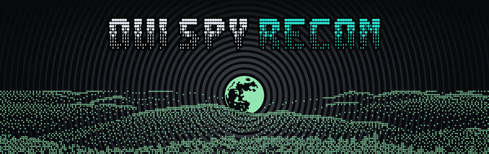

  <b>Drones, trackers, cameras and the radios around you, on your phone and on a map.</b> 
  The app for your OUI SPY boards. Android and macOS, with Linux coming. 
  No board yet? Get an OUI SPY at <a href="https://colonelpanic.tech/#products"><b>colonelpanic.tech</b></a>.

  <a href="https://github.com/colonelpanichacks/oui-spy-recon-app/releases/latest"><b>Download</b></a>
  &nbsp;&middot;&nbsp;
  <a href="https://colonelpanic.tech/#products"><b>Buy an OUI SPY</b></a>
  &nbsp;&middot;&nbsp;
  <a href="https://colonelpanichacks.github.io/oui-spy-recon-app/flasher/"><b>Flash an OUI SPY</b></a>
  &nbsp;&middot;&nbsp;
  <a href="#features"><b>Features</b></a>
  &nbsp;&middot;&nbsp;
  <a href="#a-tour-of-the-app"><b>Tour</b></a>
  &nbsp;&middot;&nbsp;
  <a href="#oui-spy-or-oui-spy-recon"><b>OUI SPY or Recon</b></a>
  &nbsp;&middot;&nbsp;
  <a href="#mesh"><b>The mesh</b></a>

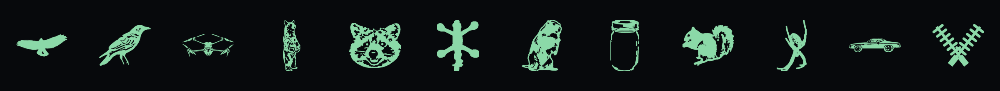

## Get started

1. **Get an OUI SPY.** The boards are at [colonelpanic.tech](https://colonelpanic.tech/#products).
2. **Install the app.** Download it for your Android phone or your Mac from [Releases](https://github.com/colonelpanichacks/oui-spy-recon-app/releases/latest).
3. **Flash your OUI SPY.** Open the [OUI SPY web flasher](https://colonelpanichacks.github.io/oui-spy-recon-app/flasher/) in Chrome or Edge on a computer and keep **OUI SPY for the app** picked. Plug the board in with a USB-C data cable, click **Connect**, pick its port, then install it. Later builds come from the app, over Bluetooth, USB or the mesh.
4. **Connect.** Open the app, go to **Settings > Connections**, switch on **Board over Bluetooth** and tap it to pick your board. The first time, it asks for the board's PIN: **123456** on a new OUI SPY (change it with `blepin` in the app's Console while the board is on USB).
5. **Keep it current.** New firmware for your board comes with the app: install it from the app's **Firmware** page. The app looks here for its own updates, and you install one from **Settings**.
6. **Grow a fleet (optional).** Boards you leave out on their own report to yours over the mesh: on the same flasher pick **Detector**, **Sky-Spy** or **Wardriver**, install it, and the page puts it on your fleet's mesh over the same cable. See [Remote nodes](#remote-nodes).

## Features

- **Live feed.** What your boards catch and, while a board wardrives, every Bluetooth device and Wi-Fi network it hears, with its signal, maker and when it was last heard.
- **Detections.** The surveillance gear around you, first: license plate readers, police body cameras, dash cams and Tasers (Axon, Motorola Solutions, WatchGuard, Digital Ally), recording smart glasses and other wearable cameras, security cameras (Avigilon, Axis, Hanwha Vision, Verkada, Ring), and drones (DJI, Parrot, Skydio, and any drone broadcasting Remote ID). Then trackers: AirTag and Find My, SmartTag, Tile, Chipolo, Pebblebee. The library holds 48 signature sets, each matched by what the gear broadcasts in public and named by what it is. Gear known only by its Wi-Fi (plate readers, Axis, Hanwha Vision, Verkada, WatchGuard, Digital Ally) takes a Recon. Flag any other device yourself, and get alerts.
- **Drones.** Remote ID over Bluetooth and Wi-Fi (on an OUI SPY, while it runs Sky Spy): the drone and its pilot live on the map, its path as it flies, where you were when you detected it and how far away it was, and an FAA lookup.
- **Map.** Detections, drones, your boards and your track on one map, with tools to drop a pin, draw an area that alerts when something enters it, measure, follow a drone, a node or yourself, and save the map for offline use.
- **Wardriving.** Log the Wi-Fi networks and Bluetooth devices you pass, with GPS (your phone's, or a Recon's own), session by session, on its own map.
- **Device pages.** Name a device, group it, keep notes, watch it, mute its alerts, hunt it and export it. A drone's page also tags it friendly, neutral, suspicious or hostile, shows it on the map and follows it.
- **Triangulation.** Three boards placed on the map that hear the same device put it on the map.
- **The mesh.** Run several boards on a long-range mesh and see the whole fleet from one phone. Remote nodes (Detector, Sky-Spy, Wardriver) install and join it straight from the web flasher, and firmware updates travel over the mesh too.
- **Firmware.** The app carries the firmware for your OUI SPY boards and updates them over Bluetooth, USB or the mesh. A new board's first install is done with the web flasher.
- **On the desktop.** The same app on macOS. Linux is coming.

## A tour of the app

Every screen below is the app itself, drawn with made-up data: a park in Denver, made-up devices with made-up addresses, made-up boards. The numbers on each screen match its key.

**Contents:** [Linking a board](#linking) &middot; [The live feed](#feed) &middot; [Detections: surveillance gear and drones](#detections) &middot; [Flag any device as a detection](#flag) &middot; [Alerts for a specific device](#alerts-for-a-specific-device) &middot; [The map](#map) &middot; [Drones](#drones) &middot; [Wardriving](#wardrive) &middot; [Hunting a device](#hunt) &middot; [FPV video (Recon)](#fpv) &middot; [The mesh and your fleet](#mesh) &middot; [Firmware](#firmware) &middot; [Settings, exports and updates](#settings) &middot; [With an OUI SPY](#ouispy)

### Linking a board

Link a board over Bluetooth, or with a USB cable to a phone or a Mac. With nothing linked, the app says so and points you to Connections.

#### First launch

The app as it first opens, before any board is linked: the Devices tab, empty, says no board is connected and how to link one.

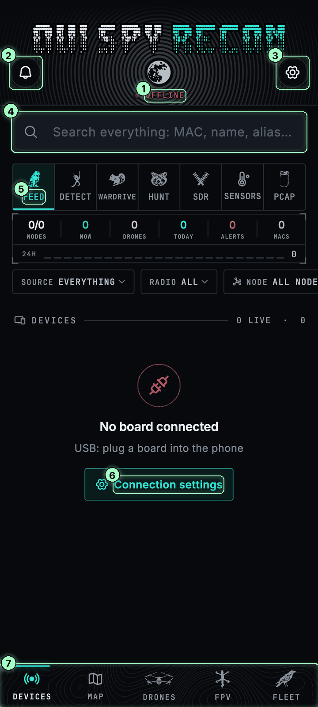
<table><tr><td width="340" valign="top"><ol><li><b>Link status</b>: Red while nothing is linked; under the moon, it names the live links once a board connects.</li><li><b>Alerts bell</b>: Opens the alerts, newest first: a filter catching a device not heard in the last minute, unless you muted it.</li><li><b>Settings</b>: Opens Settings: connections, alerts, the map, updates.</li><li><b>Search everything</b>: One search across devices, alerts, drones, nodes, wardrive sightings and FPV channels.</li><li><b>Devices modules</b>: Feed, Detect, Wardrive, Hunt, SDR, Sensors and PCAP: the Devices tab&#x27;s own tabs.</li><li><b>Connection settings</b>: Goes straight to Settings to switch on Bluetooth or USB.</li><li><b>Main tabs</b>: Devices, Map, Drones, FPV and Fleet along the bottom.</li></ol></td></tr></table>
 

#### Connect a board

Settings > Connections on a first launch: switch on Board over Bluetooth and tap it to pick your Recon, or plug a board into the phone.

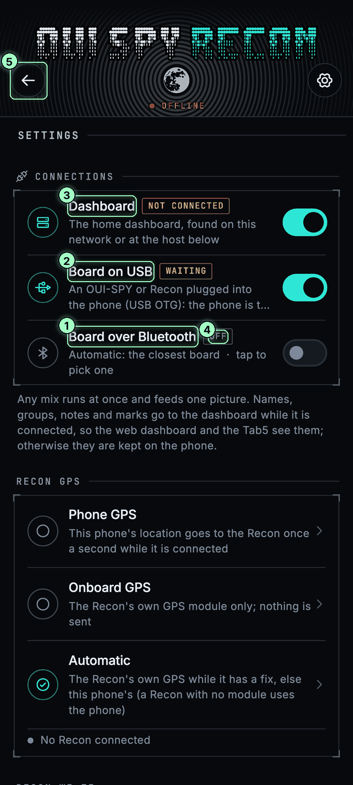
<table><tr><td width="340" valign="top"><ol><li><b>Board over Bluetooth</b>: Switch it on, then tap the row to pick your Recon or OUI SPY from the boards nearby. Left on Automatic, a phone takes the closest board, a Recon first; a Mac links only to the board picked.</li><li><b>Board on USB</b>: A Recon or OUI SPY plugged into the phone with a USB OTG cable.</li><li><b>Home dashboard</b>: The optional home dashboard, found on this network or at the host below.</li><li><b>Link state</b>: Each link says Off, Waiting, Not connected, Connecting or Live (Home down when the mesh&#x27;s home is silent; Refused when the dashboard turns the app away).</li><li><b>Back</b>: Back to the tabs.</li></ol></td></tr></table>
 

#### Settings: connections

Settings with the Recon linked over Bluetooth: each connection's switch and state, and where the Recon takes its position from.

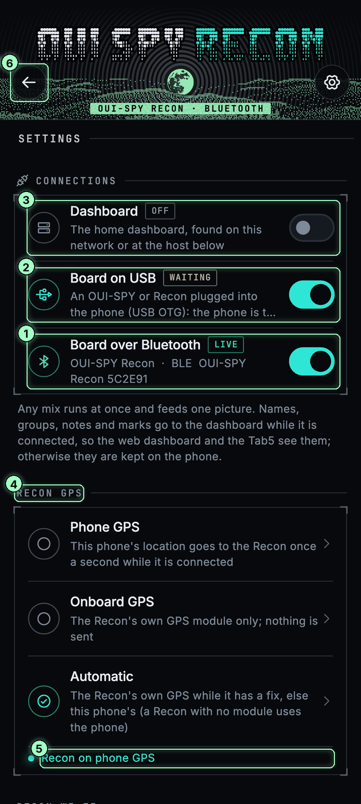
<table><tr><td width="340" valign="top"><ol><li><b>Bluetooth link</b>: Live: the Recon over Bluetooth, and its node ID. Tap the row to pick another board.</li><li><b>Board on USB</b>: A board plugged into the phone; it runs beside the Bluetooth link.</li><li><b>Home dashboard</b>: The optional home dashboard; off here.</li><li><b>Recon GPS</b>: Where the Recon&#x27;s position comes from: this phone, its own GPS module, or automatic.</li><li><b>In use now</b>: What the Recon says it uses now.</li><li><b>Back</b>: Back to the tabs.</li></ol></td></tr></table>
 

### The live feed

Everything your boards hear, live: Bluetooth devices, Wi-Fi networks and drones, with their signal, their maker and when each was last heard. Search finds anything by address, name or alias.

#### Devices: the Feed

With the Recon linked, the Feed lists every device the fleet hears, newest first: detections and ordinary devices, under a strip of live counts.

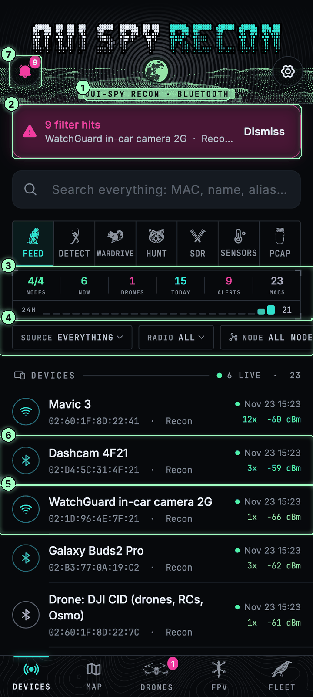
<table><tr><td width="340" valign="top"><ol><li><b>Live link</b>: The links that are up: here the Recon over Bluetooth. The moon lights up and the mountains rise while a Recon is live.</li><li><b>Alert banner</b>: New detections: tap it for the alerts, or Dismiss.</li><li><b>Live counts</b>: Nodes online, devices heard in the last minute, live drones, devices heard today, unread alerts and every MAC kept; under them, the devices heard in each of the last 24 hours, and their total.</li><li><b>Narrow the list</b>: Source, radio, node, sort, group, what caught it, and Export.</li><li><b>A detection</b>: A device a filter caught, titled by what caught it: here a WatchGuard in-car camera, by its Wi-Fi name. Its MAC, the node that heard it, when and how loud.</li><li><b>An ordinary device</b>: Everything else the wardrivers hear (the Recon&#x27;s, and any node on the mesh that wardrives): Wi-Fi networks and Bluetooth devices. Tap one for its page.</li><li><b>Alerts bell</b>: The alerts, with a count of the unread ones.</li></ol></td></tr></table>
 

#### Search

One search bar on every tab: every word must match somewhere (a MAC, a name, a maker, a reason, a node), and the chips say what matched in each part of the app.

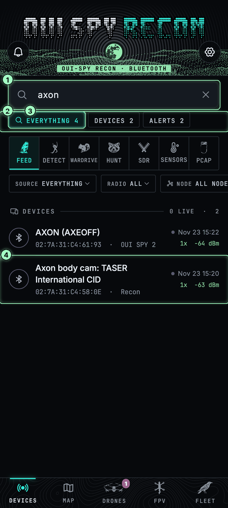
<table><tr><td width="340" valign="top"><ol><li><b>Search bar</b>: Type anything: here &quot;axon&quot;.</li><li><b>Everything</b>: Every match in the app, in one sheet.</li><li><b>By area</b>: How many matches each part has: devices, alerts, drones, nodes, wardrive and FPV.</li><li><b>Matches</b>: The Feed narrowed to what matches.</li></ol></td></tr></table>
 

#### Search results

Everything that matches, by part of the app: tap one to open it.

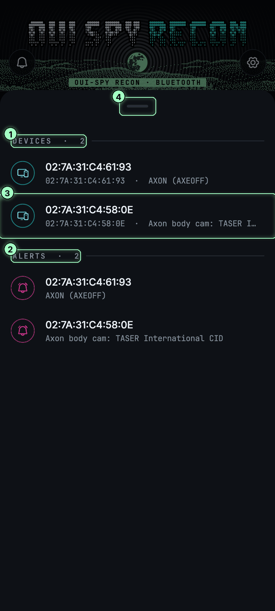
<table><tr><td width="340" valign="top"><ol><li><b>Devices</b>: The devices that match, with what caught them.</li><li><b>Alerts</b>: The alerts that match.</li><li><b>A match</b>: Tap one to open its page.</li><li><b>Close</b>: Swipe the sheet down to close it.</li></ol></td></tr></table>
 

#### A Wi-Fi network's page

An access point the Recon's wardriver logged: its name, security, channel, where and when it was heard.

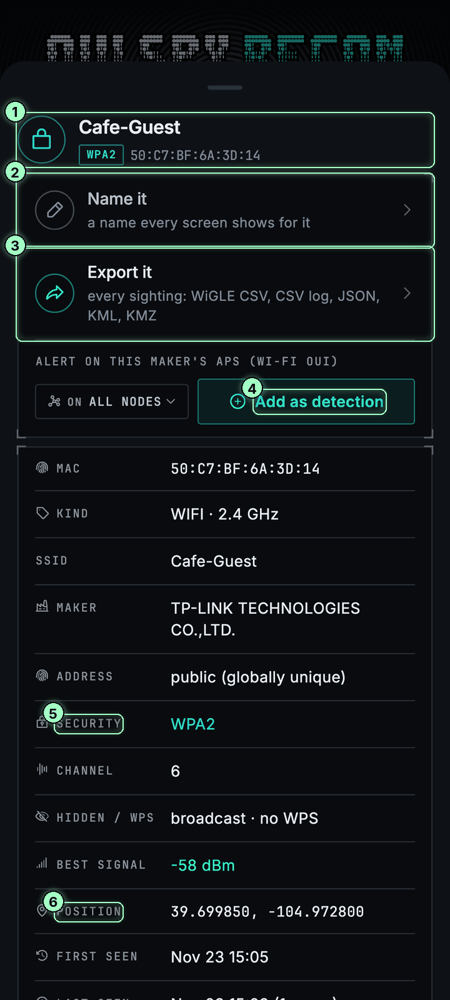
<table><tr><td width="340" valign="top"><ol><li><b>Network</b>: Its name (SSID), its security and its MAC.</li><li><b>Name it</b>: Your own name for it, on every screen.</li><li><b>Export it</b>: Every sighting of it: WiGLE CSV, CSV log, JSON, KML or KMZ.</li><li><b>Alert on it</b>: Wi-Fi filters match a maker&#x27;s prefix, so this watches every access point by this maker (it asks first). A random address has no maker prefix, so nothing is added for it.</li><li><b>Security</b>: WPA2 here, in cyan; open networks show in green, WPA in amber, WEP in red, WPA3 in violet.</li><li><b>Where</b>: Where the wardriver placed it; when it was first and last heard follow below.</li></ol></td></tr></table>
 

### Detections: surveillance gear and drones

The app's signature library has 48 entries, makers and families of gear: police body cameras, in-car cameras and radios, security cameras, recording smart glasses, and drones by Remote ID. Each detection is named by what it is and has a page of its own.

#### Detect: detections

Detect lists what every board's filters caught, each device once, with the Remote ID drones heard: here the last five minutes.

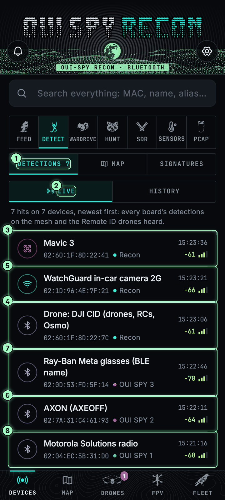
<table><tr><td width="340" valign="top"><ol><li><b>Detections</b>: What the boards caught, newest first; Map shows where, Signatures what is watched for.</li><li><b>Live or History</b>: Live: the last five minutes. History: everything kept.</li><li><b>Remote ID drone</b>: A drone by its own Remote ID broadcast; its page has its pilot and flight.</li><li><b>DJI gear</b>: A DJI drone, controller or Osmo camera, caught by the Drones preset&#x27;s DJI company ID.</li><li><b>In-car camera</b>: A WatchGuard in-car camera, caught by a watch rule on its Wi-Fi name, on the Recon&#x27;s 2.4 GHz scan.</li><li><b>AXEOFF hit</b>: Axon gear caught by OUI SPY 2 running AXEOFF, the headless Axon detector.</li><li><b>Smart glasses</b>: Ray-Ban Meta glasses, caught by their Bluetooth name (the Meta family of the watch list).</li><li><b>Motorola radio</b>: A Motorola Solutions radio, caught by OUI SPY 1 on a rule from the watch list.</li></ol></td></tr></table>
 

#### A detection's page

A detection's page: what caught it, its signal and when it was last heard, who heard it, and what you can do with it.

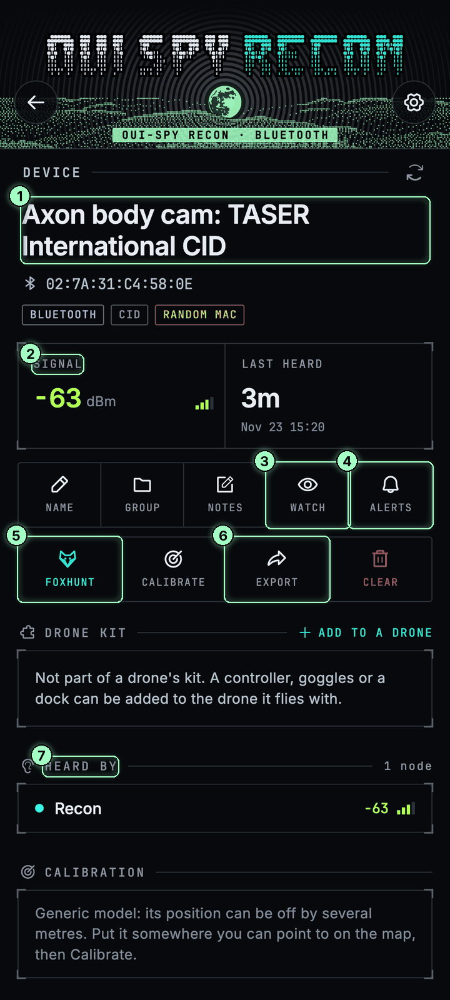
<table><tr><td width="340" valign="top"><ol><li><b>What it is</b>: Named for what caught it: the Axon preset, by the company ID in its Bluetooth advert. Name gives it your own name.</li><li><b>Signal and time</b>: Its best signal now and when it was last heard.</li><li><b>Watch it</b>: Puts its address on your watch list, with your label. When a board catches it, the alert reads Watched device, with your label and its own sound, even if muted.</li><li><b>Mute alerts</b>: Mutes its alerts, unless it is on your watch list.</li><li><b>Foxhunt</b>: Opens FIND IT: a pulse that quickens as its signal rises, from the node that hears it best. Hunt it on the Recon there switches the Recon to Foxhunter for it (asks first).</li><li><b>Export</b>: Its detections as CSV, JSON, KML or KMZ.</li><li><b>Heard by</b>: The nodes that hear it and how loud, the closest first.</li></ol></td></tr></table>
 

#### Caught by a node

A Motorola Solutions radio, caught by OUI SPY 1 out on the mesh on a rule from your watch list: its Bluetooth company ID.

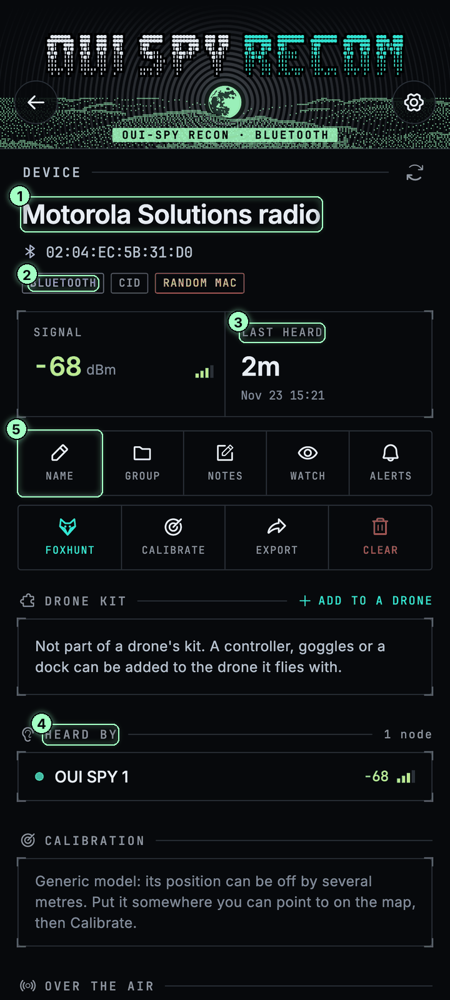
<table><tr><td width="340" valign="top"><ol><li><b>What caught it</b>: The watch rule&#x27;s own words: what you called it when you added it.</li><li><b>Its radio</b>: Heard on Bluetooth; CID: matched by its company ID, whatever its address.</li><li><b>Last heard</b>: When a node last heard it.</li><li><b>Heard by</b>: OUI SPY 1 heard it: the mesh brought the catch to the Recon and the phone.</li><li><b>Name it</b>: Your own name for it, on every screen.</li></ol></td></tr></table>
 

#### Alerts

A board's detection raises an alert the first time, and again once the device has gone a minute unheard, unless you muted it: Axon gear, cameras, smart glasses, DJI gear, trackers. Remote ID drones get their own drone notice. Newest first, the unread ones lit.

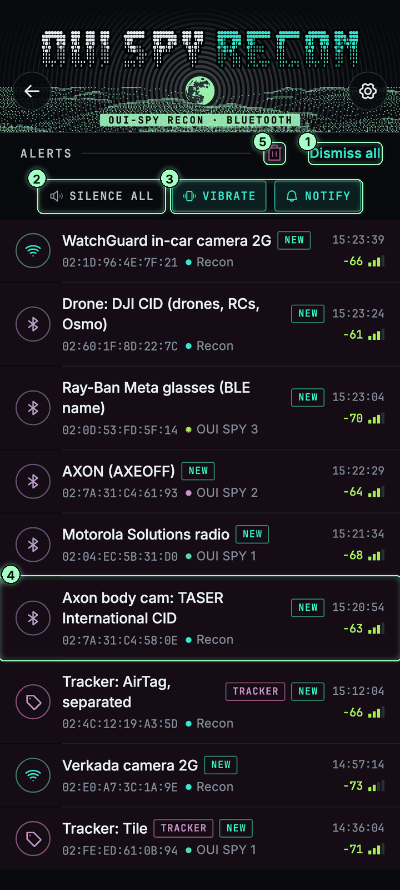
<table><tr><td width="340" valign="top"><ol><li><b>Dismiss all</b>: Marks every alert read; the banner goes.</li><li><b>Silence all</b>: No sound, buzz, banner or notification until you switch it off or the app restarts.</li><li><b>Vibrate and notify</b>: How alerts reach you on this phone.</li><li><b>An alert</b>: What was caught (here an Axon body camera, by its Bluetooth company ID), its MAC, the node that heard it, when and how loud. Swipe left to mute it; tap for its page.</li><li><b>Clear detections</b>: Deletes every stored detection (asks first).</li></ol></td></tr></table>
 

#### Detect: signatures

What the phone and the nodes watch for: families from the signature library and your own rules. Install on nodes adds the list to the nodes you pick (the online detectors and Recons come ticked); maker rules stay on the phone.

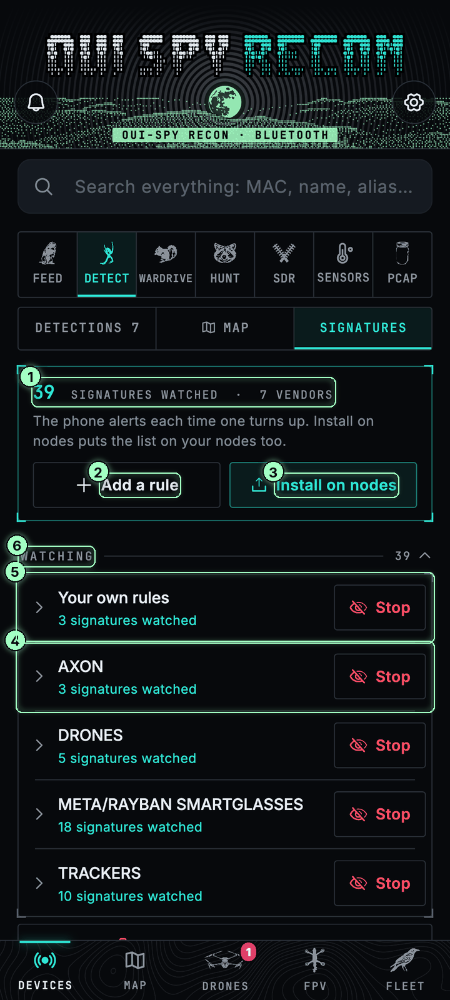
<table><tr><td width="340" valign="top"><ol><li><b>Watched</b>: How many signatures are watched, and how many library entries (makers or families) have one on the list.</li><li><b>Add a rule</b>: Your own rule: a MAC, a maker prefix, a name (part, start or pattern), a Bluetooth company ID, company data or service, a Wi-Fi probe or beacon prefix, or a maker&#x27;s name (phone only).</li><li><b>Install on nodes</b>: Adds the list to the nodes you pick, so they catch it, beep and flash; the phone alerts on what they catch.</li><li><b>A watched family</b>: Each family watched, with its signatures. Stop takes it off the phone&#x27;s list (asks first); nodes keep the filters already installed.</li><li><b>Your own rules</b>: Rules you added: Motorola Solutions&#x27; Bluetooth company ID, and two camera makers by their Wi-Fi names.</li><li><b>Watching</b>: Everything watched, by family; the whole signature library follows below, by kind.</li></ol></td></tr></table>
 

#### Detect: trackers

History keeps every detection. The Trackers chip narrows it to item trackers: an AirTag and a Tile caught earlier this afternoon.

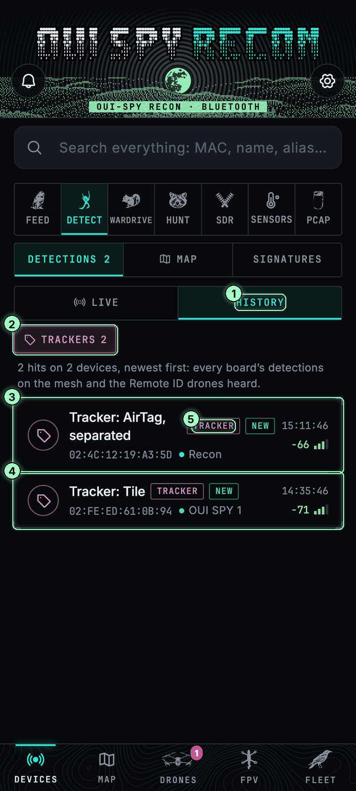
<table><tr><td width="340" valign="top"><ol><li><b>History</b>: Everything kept, not only the last five minutes.</li><li><b>Trackers only</b>: Narrows the list to item trackers (AirTag, SmartTag, Tile...); tap again for everything.</li><li><b>An AirTag</b>: An AirTag away from its owner, caught by the Trackers preset from its Find My advert.</li><li><b>A Tile</b>: A Tile, caught by OUI SPY 1 by its Bluetooth service.</li><li><b>Its kind</b>: Trackers are marked in pink in Detect, the alerts and the detection map.</li></ol></td></tr></table>
 

#### A tracker's page

An AirTag separated from its owner: caught by the Trackers preset from its Find My advert. Foxhunt opens FIND IT, where the Recon can hunt it.

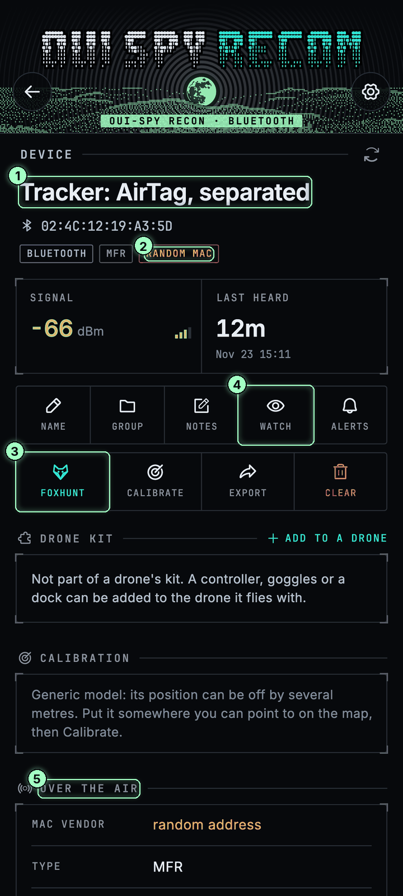
<table><tr><td width="340" valign="top"><ol><li><b>Tracker</b>: What it is: an AirTag that is away from its owner.</li><li><b>Random MAC</b>: Its address changes: it is matched by what it broadcasts, not by its MAC.</li><li><b>Foxhunt</b>: Opens FIND IT: a pulse that quickens as its signal rises, from the node that hears it best. Hunt it on the Recon there switches the Recon to Foxhunter for it (asks first).</li><li><b>Watch it</b>: Puts its current address on your watch list. A tracker changes its address, so this holds only until it does; the Trackers preset still catches it by its Find My advert.</li><li><b>Over the air</b>: What was kept of it: its address&#x27;s maker, the kind of rule that caught it, first and last seen, best signal.</li></ol></td></tr></table>
 

### Flag any device as a detection

Any Bluetooth device a wardriver logged can become a detection, by its MAC. Here a plain device in the feed is flagged, the filter goes to the nodes over the mesh, and the next time a node catches it you get an alert.

#### Flag a device: 1

Any Bluetooth device a wardriver logged can become a detection, by its MAC (a Wi-Fi network only by its maker's prefix, which catches every network of that maker). Here a dashcam's Bluetooth keeps turning up in the Feed: an ordinary device, caught by no filter.

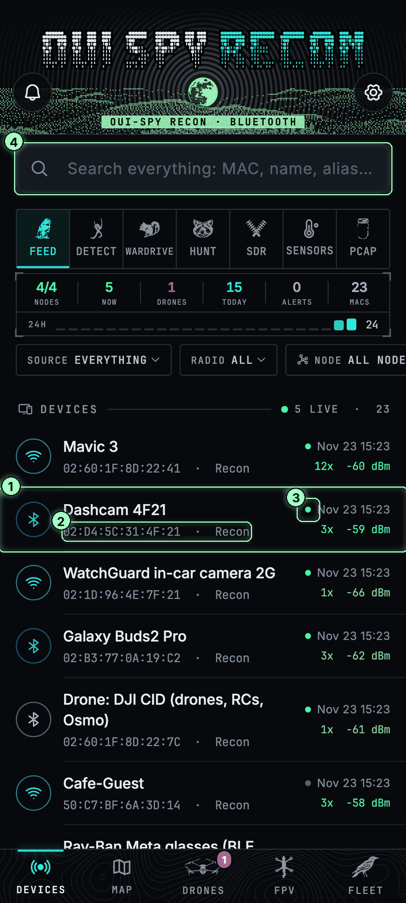
<table><tr><td width="340" valign="top"><ol><li><b>The device</b>: A Bluetooth device the Recon hears: tap it for its sheet.</li><li><b>Its MAC</b>: Its address, and the node that heard it.</li><li><b>Heard now</b>: Green while heard in the last minute.</li><li><b>Search</b>: Or find it by name, MAC or maker.</li></ol></td></tr></table>
 

#### Flag a device: 2

Its sheet: a Bluetooth device's name, address and signal, and the control that makes it a detection on the nodes.

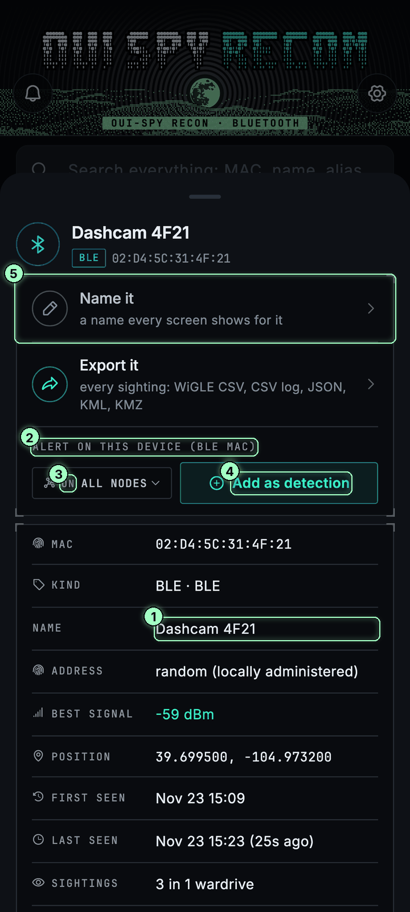
<table><tr><td width="340" valign="top"><ol><li><b>The device</b>: Its name as it broadcasts it, and its MAC.</li><li><b>Alert on it</b>: A filter for this one device, by its Bluetooth MAC. This address is random: if the device changes it, the filter no longer matches.</li><li><b>On which nodes</b>: All nodes, or one node.</li><li><b>Add as detection</b>: Sends the filter to those nodes: from then on, a node running its Detector reports it as a detection.</li><li><b>Name it</b>: A name of your own first, if you like: the filter takes it.</li></ol></td></tr></table>
 

#### Flag a device: 3

Add as detection: the filter goes over the mesh to each online node that takes filters, and the phone says which took it and which refused, with Undo. Here OUI SPY 2 is running AXEOFF, so it refuses: a node takes filters only while its Detector runs.

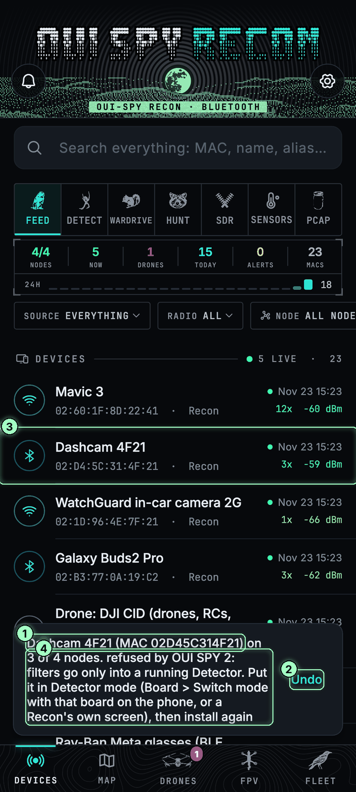
<table><tr><td width="340" valign="top"><ol><li><b>Added</b>: The filter: the device&#x27;s Bluetooth MAC, named after it.</li><li><b>Undo</b>: Takes it back off the same nodes.</li><li><b>The device</b>: Still an ordinary device here: it becomes a detection the next time a node hears it.</li><li><b>Detector nodes</b>: On 3 of 4 nodes: OUI SPY 2 refused it, because a node takes filters only while its Detector runs. The toast says how to switch it.</li></ol></td></tr></table>
 

#### Flag a device: 4

The rule it made, on the node: OUI SPY 1's filter list now ends with the dashcam's MAC, named after it. Fleet > a node > Filters on the node shows it.

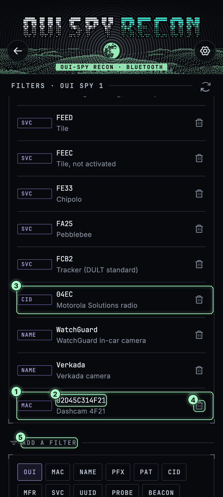
<table><tr><td width="340" valign="top"><ol><li><b>The new filter</b>: An exact-MAC filter, named for the device: the rule Add as detection made.</li><li><b>Its MAC</b>: The address it matches.</li><li><b>Your rules</b>: The rest of the list: your watch list, installed on the node earlier (Install on nodes).</li><li><b>Remove one</b>: Takes a filter off the node.</li><li><b>Add a filter</b>: Or type one in here: a MAC, a maker prefix, a name (part, start or pattern), a Bluetooth company ID, company data or service, a Wi-Fi probe or beacon prefix.</li></ol></td></tr></table>
 

#### Flag a device: 5

The next time a node hears it, it is a detection like any other: an alert, the banner, and its row on top of the Feed.

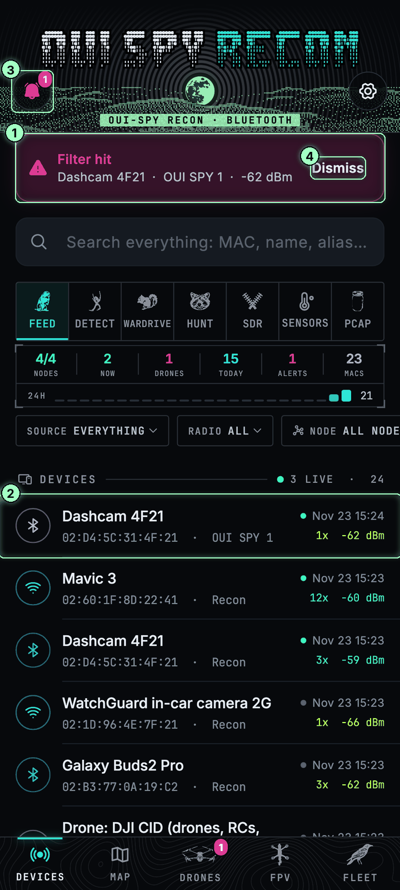
<table><tr><td width="340" valign="top"><ol><li><b>The alert</b>: What it is, the node that caught it, and how loud.</li><li><b>The detection</b>: Its row on top of the Feed, now a detection.</li><li><b>Alerts bell</b>: One unread alert.</li><li><b>Dismiss</b>: Marks it read.</li></ol></td></tr></table>
 

#### Flag a device: 6

In Detect it is listed with the surveillance gear and the drones: the dashcam, caught by OUI SPY 1 on the filter added for it.

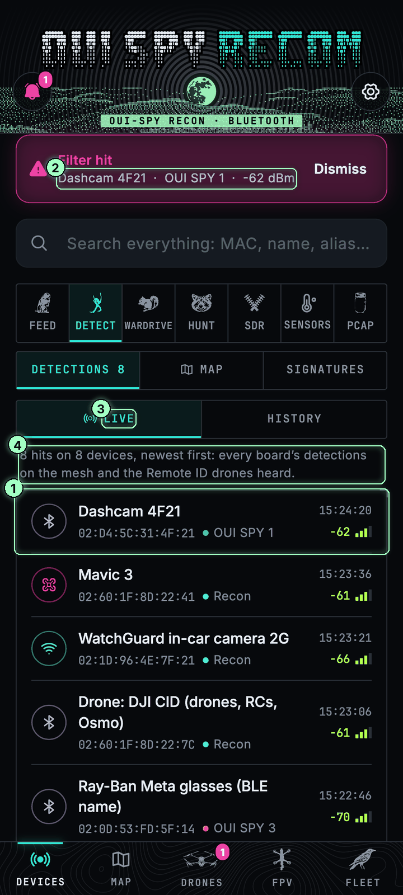
<table><tr><td width="340" valign="top"><ol><li><b>Now a detection</b>: Caught by OUI SPY 1: titled with the filter&#x27;s words.</li><li><b>Its node</b>: The node whose filter caught it.</li><li><b>Live</b>: Caught in the last five minutes.</li><li><b>Count</b>: How many devices are listed, each once.</li></ol></td></tr></table>
 

### Alerts for a specific device

**Add as detection**, above, sends a filter for a wardrive find straight to your boards. To give a device a label of your own and an alert of its own, watch it:

1. Open the device's page: tap it in **Devices > Detect**, or find it with search. From the Feed, Wardrive or a map, tap it, then **Device page**.
2. Tap **Watch**. The **WATCH FOR** sheet opens with the device's address filled in.
3. Give it a label that says what it is. The label is the **WATCHED** notification's text, and the description of the filter on your nodes.
4. Tap **Watch for it**. The device page now reads **Watched**.
5. Put it on your boards: **Devices > Detect > Signatures > Install on nodes**. The phone alerts only on what a board catches, so without this it never alerts. A Recon or an OUI SPY takes rules while its Detector runs (**Fleet > Board > Switch mode > Detector**).

When a board catches it, you get a **Watched device** banner and a **WATCHED** notification with your label and its own sound, even if you muted that device. It is listed in **Detect > Detections**, drawn on the maps, and your boards can beep and flash.

**Whole families.** **Devices > Detect > Signatures > Add a rule** watches anything that fits a pattern: a maker's address prefix, an exact address, a name or part of one, a Bluetooth company ID or service UUID, or a Wi-Fi probe or beacon prefix. **Signatures** also lists the 48 signature sets above: tick one to watch all its gear.

**Sounds.** **Settings > Alerts on this phone > Sound** sets a sound for each kind of event: filter hits, trackers, watched devices, drones, and nodes going down or coming back.

### The map

Detections, drones, your boards and your track on one map. The option rows turn layers on and off, and the tools along the bottom drop pins, draw areas, measure and lock the map on you.

#### The MAP tab

Your Recon and its mesh of OUI SPY nodes, a drone in the air with its pilot and where it was detected from, and the devices the mesh detected, on the map.

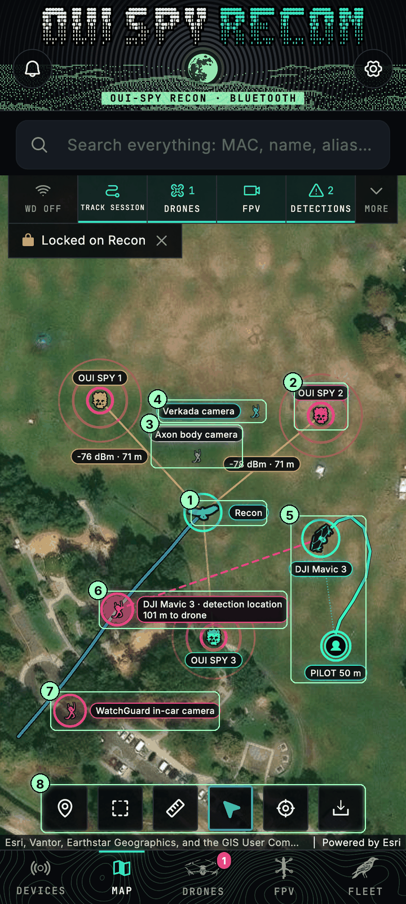
<table><tr><td width="340" valign="top"><ol><li><b>You, the Recon</b>: The Recon in your hand is you and the home of the mesh; the map locks on it, and no drag or zoom moves it off until you let go or lock on something else.</li><li><b>Mesh node</b>: An OUI SPY node placed on the map. The line to the Recon is its mesh link, with its signal and length; red rings pulse out when it detects something.</li><li><b>Axon body camera</b>: A detection placed among the nodes that hear it, named by what it is.</li><li><b>Verkada camera</b>: A detection heard by two nodes, placed between them.</li><li><b>Drone and pilot</b>: A drone sending Remote ID, ringed green while it is live (heard in the last minute, by default), its path behind it, and its pilot with the distance between them.</li><li><b>Detection location</b>: Hot pink: where you were when the drone was detected, with a dashed line to the drone and the range to it.</li><li><b>Watched device</b>: A device flagged by your own watch rule, ringed red where the wardrive heard it.</li><li><b>Map tools</b>: Drop a pin, draw an area, measure, lock on you, fit the view (this lets go of any lock), and save this view&#x27;s map tiles for offline use.</li></ol></td></tr></table>
 

#### Map options

The rows of options along the top of the map, MORE opened: what the map shows, each changed with a tap.

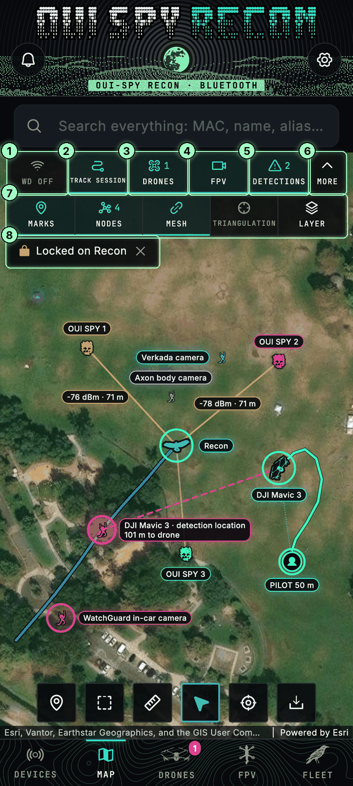
<table><tr><td width="340" valign="top"><ol><li><b>Wardrive dots</b>: Every device the wardrive placed: off, this session, or every wardrive.</li><li><b>Drive tracks</b>: The path you walked or drove: this session, every drive, or none.</li><li><b>Drones on map</b>: Off, the drones heard in the last 5 minutes with their pilots and paths, or every drone in the Drones tab&#x27;s time window (history).</li><li><b>FPV finds</b>: Analog video transmitters the FPV receiver found, pinned where you heard them.</li><li><b>Detections on or off</b>: The detected and watched devices the wardrive placed, on or off whatever else is shown.</li><li><b>More options</b>: Opens a second row of options; tap again to close it.</li><li><b>Second row</b>: Marks, the mesh&#x27;s nodes, the links between them, triangulation, and the map layer.</li><li><b>Locked on you</b>: The map follows what it is locked on; the cross lets go.</li></ol></td></tr></table>
 

#### The detection map

Devices > Detect > Map: every detection where it was heard (on your walk, at a fix, or as a count on the node that heard it), and how many have no position yet.

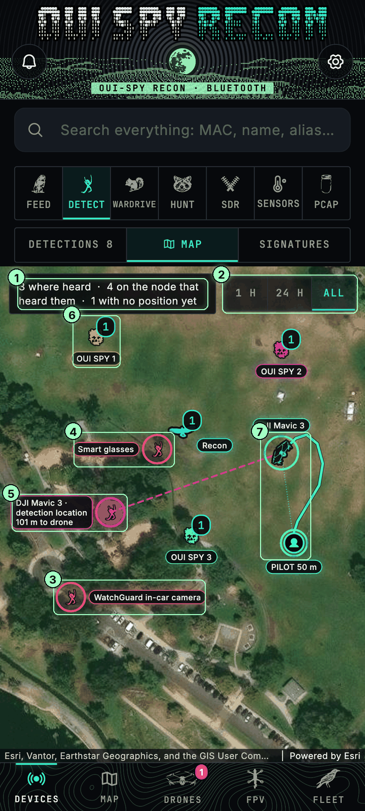
<table><tr><td width="340" valign="top"><ol><li><b>What is placed</b>: How many detections are placed where they were heard, at a fix, or on the node that heard them, and how many have no position yet.</li><li><b>Time window</b>: The last hour, the last day, or every detection kept.</li><li><b>Watched device</b>: A detection ringed red where it was heard; tap for the device.</li><li><b>Smart glasses</b>: A detection placed where you were when the Recon heard it.</li><li><b>Drone detection</b>: The drone&#x27;s detection location in hot pink, its dashed line to the drone in the air.</li><li><b>Heard by a node</b>: A count on a node: its detections that are not placed anywhere else; tap to list them.</li><li><b>Live drone</b>: The drone and its pilot, live.</li></ol></td></tr></table>
 

### Drones

Drones broadcasting Remote ID, live: the drone, its pilot, its path, the spot you detected it from with the range to it, and an FAA lookup by serial.

#### Drones

Every drone heard in the time window, the ones in the air first: Remote ID drones and the FPV transmitters the receiver found.

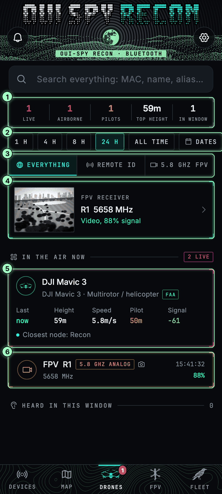
<table><tr><td width="340" valign="top"><ol><li><b>Drone counts</b>: Remote ID drones only: live now, in the air, pilots located, the highest one&#x27;s height, and how many in the window.</li><li><b>Time window</b>: 1, 4, 8 or 24 hours, all time, or dates you pick.</li><li><b>Remote ID or FPV</b>: Both kinds, Remote ID drones only, or 5.8 GHz FPV video only.</li><li><b>FPV receiver</b>: The Recon&#x27;s video receiver: where it is tuned and what it sees; tap for its screen.</li><li><b>Drone in the air</b>: A live drone: its make (from the FAA record when there is one), when it was last heard, height, speed, how far its pilot is, its signal.</li><li><b>FPV transmitter</b>: An analog video transmitter found on R1, 5658 MHz; tap to tune the receiver to it.</li></ol></td></tr></table>
 

#### A drone's page

One drone: its make (from the FAA record when there is one), its path, its pilot and where it was detected from on its own map, and what you can do with it.

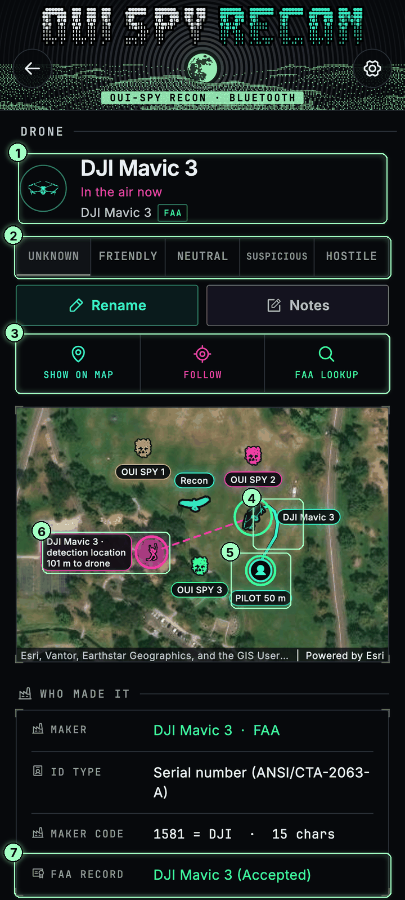
<table><tr><td width="340" valign="top"><ol><li><b>Drone and maker</b>: Its name, in the air now or when it was last heard, and its make and model with where that came from.</li><li><b>Its tag</b>: Tag it friendly, neutral, suspicious or hostile.</li><li><b>Follow and FAA</b>: Show it on the MAP tab, follow it there, or look its serial up in the FAA registry again.</li><li><b>Live path</b>: Where the drone has flown this flight, from its first report to now.</li><li><b>Drone pilot</b>: Its pilot, and the distance between them.</li><li><b>Detection location</b>: Where you were when the Recon first heard this flight, and the range to the drone.</li><li><b>FAA record</b>: What the FAA registry says about this serial: make, model and status.</li></ol></td></tr></table>
 

#### Following a drone

Follow on the drone's page: the MAP tab locked on the drone, keeping it in the middle as it flies; the cross lets go.

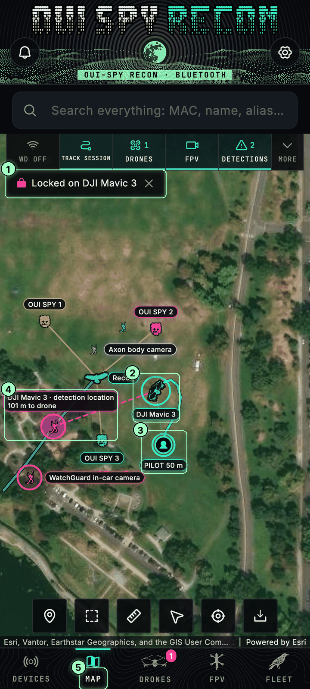
<table><tr><td width="340" valign="top"><ol><li><b>Locked on the drone</b>: The map follows the drone; no drag or zoom moves it off. The cross lets go, as do fit the view and lock on you.</li><li><b>Followed drone</b>: The drone stays in the middle of the map as it flies; zoom as you like.</li><li><b>Its pilot</b>: Its pilot, with the distance to the drone.</li><li><b>Detection location</b>: Where you were when it was detected; the dashed line follows the drone.</li><li><b>Map tab</b>: Follow brings you to the MAP tab.</li></ol></td></tr></table>
 

### Wardriving

Log the Wi-Fi networks and Bluetooth devices you pass (and 802.15.4 devices on a Recon), with GPS, session by session, on its own map.

#### Wardriving

Devices > Wardrive with a wardrive running on your walk: every device it heard as a dot where it was heard loudest, your track, and the detections ringed.

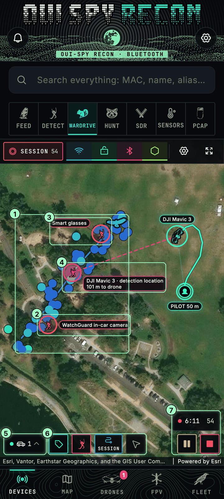
<table><tr><td width="340" valign="top"><ol><li><b>Session dots</b>: Each dot is a device the wardrive heard, placed where it was heard loudest: Wi-Fi networks in the colour of their security, Bluetooth in blue, 802.15.4 in lime.</li><li><b>Watched device</b>: A device your own watch rule flags, ringed red with its name.</li><li><b>Smart glasses</b>: A detection, ringed red where the wardrive heard it.</li><li><b>Detection location</b>: Where the wardrive heard the drone, with the range to the drone itself.</li><li><b>Who is wardriving</b>: This Recon, with its wardriver&#x27;s ON or OFF switch, and every node on the mesh that wardrives; tap for each one&#x27;s count.</li><li><b>Map buttons</b>: Names on the map, the detections on or off, the track (session, all or off), and lock on you.</li><li><b>Recording time</b>: How long this wardrive has run and how many devices it found; pause it, or stop it to save it (in Auto, the next sighting starts a new one).</li></ol></td></tr></table>
 

### Hunting a device

Walk to a device: FIND IT turns its signal into a number that climbs as you get closer. On a Recon, the spin sweep uses its motion sensor to turn a slow turn on the spot into a bearing.

#### Fox hunt: pick a device

Devices > Hunt: the detections and wardrive sightings you can hunt, newest first, with the Recon hunting the WatchGuard in-car camera.

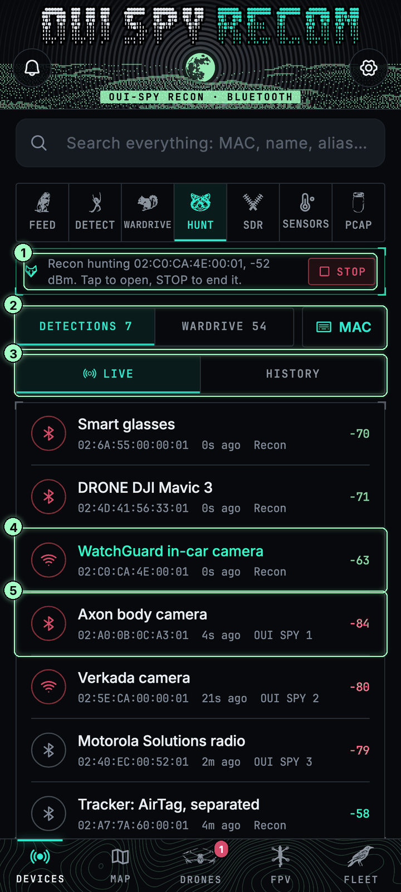
<table><tr><td width="340" valign="top"><ol><li><b>Hunting now</b>: What the Recon is hunting and its signal; tap to open the hunt, STOP ends it.</li><li><b>Detections or wardrive</b>: Hunt a detection, or any device a wardrive heard; MAC types an address in.</li><li><b>Live or history</b>: Detections heard in the last 5 minutes, or all of them, each device once.</li><li><b>The hunted device</b>: The device being hunted, in green. Tap any row to open its hunt (FIND IT); Hunt it on the Recon there sets the Recon on it.</li><li><b>A detection</b>: Each detection with its MAC, when it was heard, by which node, and its signal; newest first.</li></ol></td></tr></table>
 

#### Fox hunt: find it

FIND IT on the WatchGuard in-car camera: the Recon's foxhunter reading, a pulse that quickens as you get closer, and a spin sweep with the yagi under way.

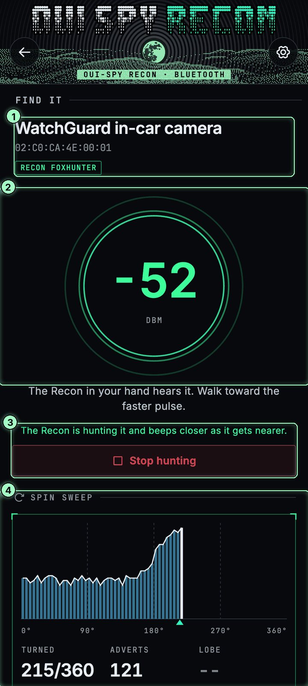
<table><tr><td width="340" valign="top"><ol><li><b>Hunted device</b>: What you hunt, its address, and where its signal comes from: the Recon&#x27;s foxhunter.</li><li><b>Signal pulse</b>: Its signal in dBm: the ring pulses, and the phone buzzes with each pulse, faster the closer you get (no buzz on a Mac or Linux).</li><li><b>Hunting on the Recon</b>: The Recon is hunting it and, with its buzzer on, beeps faster as you get nearer; stop the hunt here.</li><li><b>Spin sweep</b>: With the yagi fitted, turn once on the spot: the Recon logs the signal against its heading.</li></ol></td></tr></table>
 

#### Fox hunt: the bearing

The spin sweep done: the bearing of the strongest signal, how far to turn, and, once the Recon knows north, the sweeps' lines crossing at the device.

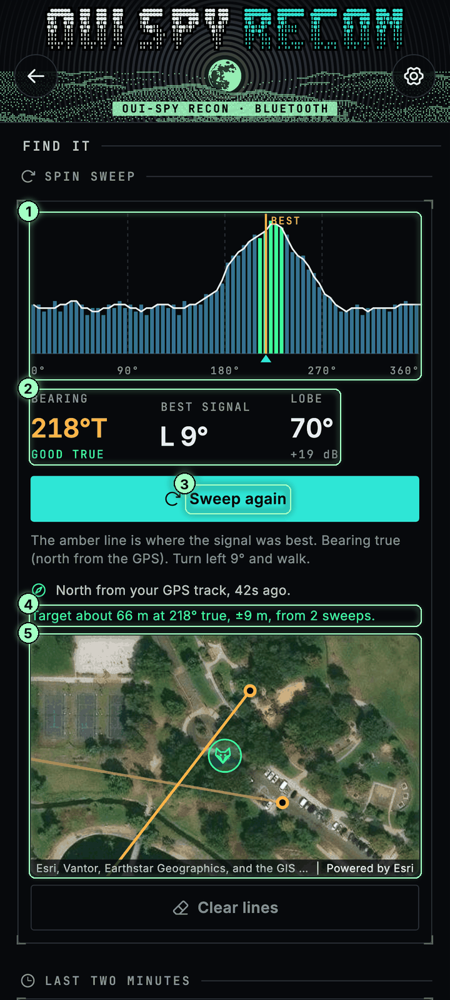
<table><tr><td width="340" valign="top"><ol><li><b>Signal by heading</b>: The signal at each heading of the turn; the amber line marks the best.</li><li><b>Bearing and turn</b>: The bearing (true once the Recon has north from a short straight walk with GPS; until then, from the way you faced at the start), how far to turn to face it, and the lobe&#x27;s width.</li><li><b>Sweep again</b>: Sweep again from here, or from a spot to the side for a fix.</li><li><b>Where they cross</b>: Two or more sweeps from different spots, with north known: about how far away the target is from you, and its bearing.</li><li><b>Bearing lines</b>: Each sweep&#x27;s line on the map from where it was taken (sweeps with a GPS fix and a lobe that is not WEAK; the last 8, for 30 minutes); the green ring is where they cross.</li></ol></td></tr></table>
 

### FPV video (Recon)

The Recon's second radio receives 5.8 GHz analog FPV video: it scans the channels, flags the channels transmitters are on, and locks on to show the picture.

#### FPV: the channel scan

The Recon's 5.8 GHz receiver scanning, each channel's heat on the 48-channel map, a flag on the transmitter it found.

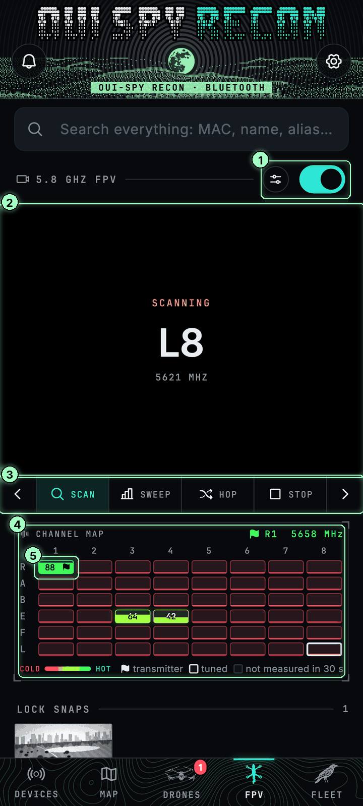
<table><tr><td width="340" valign="top"><ol><li><b>FPV on and options</b>: FPV on or off (off, the C5 scans Wi-Fi and 802.15.4), and OPTIONS: the picture, auto scan and lock snaps.</li><li><b>Scanning now</b>: The picture&#x27;s place while the receiver scans: the channel it is on now.</li><li><b>Receiver controls</b>: Channel down, SCAN, SWEEP, HOP, STOP and channel up; the one running is lit.</li><li><b>Channel map</b>: All 48 channels by band: each filled as high as its signal, red cold to green hot.</li><li><b>Transmitter flag</b>: A flag on the channel with a transmitter: R1, 5658 MHz; tap a channel to tune to it.</li></ol></td></tr></table>
 

#### FPV: the video

Tuned to R1 and locked: the drone's analog video on the phone, with the receiver's controls and the channel map under it.

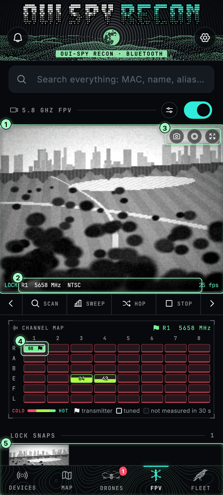
<table><tr><td width="340" valign="top"><ol><li><b>Live video</b>: The transmitter&#x27;s picture, live (half size over Bluetooth); double tap for full screen.</li><li><b>Lock and channel</b>: LOCK while the picture holds sync, the channel and frequency, PAL or NTSC, and frames a second.</li><li><b>Snapshot and record</b>: Save the picture, record every frame, or go full screen.</li><li><b>Tuned channel</b>: The channel the receiver is on, framed white.</li><li><b>Lock snaps</b>: The pictures saved at each lock, and every snapshot you take, newest first; tap one to see it large.</li></ol></td></tr></table>
 

### The mesh and your fleet

Your boards talk to each other directly over a long-range Wi-Fi link (ESP-NOW long range), with no router and no internet. Connect the app to one of them and you see what every board catches and, while it wardrives, every device it hears.

- **One OUI SPY and a phone.** Carry it, and the phone shows and maps what it catches and, while it wardrives, everything it hears.
- **Several OUI SPYs.** Leave them around a place. They report over the mesh to the one your phone is on, and three placed on the map that hear the same device triangulate it.
- **With a Recon.** The Recon is the mesh's home: it gathers what the fleet hears on its own screen and passes it to the app, and adds its second radio.

The screens below run a fleet from one phone: every node's status, rules and firmware, the whole fleet's channel, and triangulation from three placed nodes.

**[The mesh, step by step](docs/MESH.md):** setting up a fleet from the app, the fleet key, running every node from one phone, what travels over the mesh, and its limits.

#### Remote nodes

A remote node is an OUI SPY with no phone of its own: you leave it where it should watch, and it reports over the mesh to the board on your phone. The [web flasher](https://colonelpanichacks.github.io/oui-spy-recon-app/flasher/) installs one and puts it on your fleet's mesh over the same USB cable.

1. **The board on your phone.** Install **OUI SPY for the app** and pair it. In the app, **Fleet > Board > Mesh**: type a fleet key (8 to 63 characters, no spaces) and switch the mesh on. Then make it the home: **Fleet > Control > Home node**.
2. **Each remote node.** On the flasher, pick its job: **Detector** (watches for the device signatures you send it), **Sky-Spy** (drone Remote ID) or **Wardriver** (every Wi-Fi network and Bluetooth device it hears). Install it, then set it up on the page: the same channel and fleet key, a name, and a lock so it starts in the mesh after every power cut. The page can generate a key, and shows its fingerprint: the same one the app shows for every node holding it.
3. **Run them all from the app.** **Fleet** lists every node. Filters and firmware updates reach them over the mesh.

#### Fleet

The Fleet tab: the Recon is the home of the mesh, and every OUI SPY node on it is listed with its state, its link and its build.

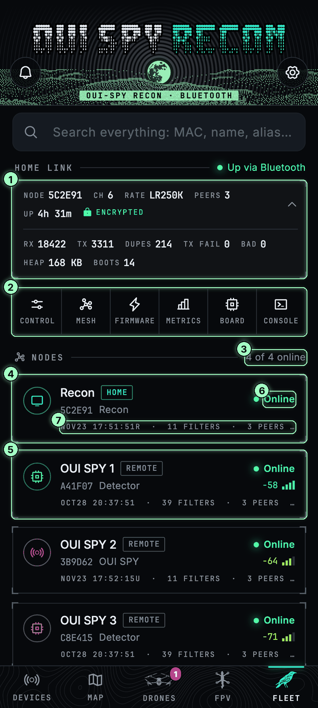
<table><tr><td width="340" valign="top"><ol><li><b>Home link</b>: The home&#x27;s mesh: its node, channel, rate, peers and uptime, encrypted with the fleet key; tap for its counters.</li><li><b>Fleet tools</b>: Control the whole fleet, the mesh&#x27;s health, firmware, metrics, the board and its console.</li><li><b>Online count</b>: How many nodes are heard now.</li><li><b>The home</b>: The Recon: the fleet&#x27;s home, on this phone over Bluetooth.</li><li><b>A node</b>: An OUI SPY node out on the mesh: its ID, what it runs, its signal to the home. Tap for its page.</li><li><b>Node state</b>: Online, Silent (quiet a while) or Offline, and how loud the home hears it.</li><li><b>Build and filters</b>: Its build, how many filters it holds, its peers and its uptime.</li></ol></td></tr></table>
 

#### A node's page

A node's page: its name, alerts, filters and firmware reach the node over the mesh; its colour stays on the phone.

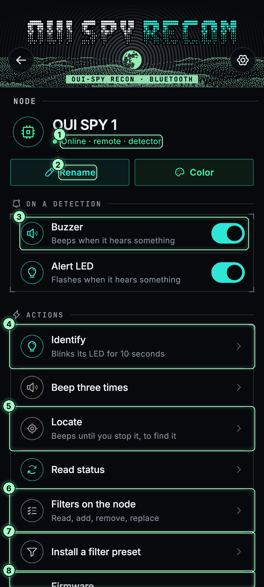
<table><tr><td width="340" valign="top"><ol><li><b>Its state</b>: Online, its role (home or remote) and what it runs.</li><li><b>Rename and colour</b>: Its name and its colour, on every screen and map.</li><li><b>Buzzer and LED</b>: Whether it beeps and flashes when it detects something.</li><li><b>Identify</b>: Beeps and blinks its LED for 10 seconds, to tell it apart.</li><li><b>Locate</b>: Beeps until you stop it, to find where it is (an OUI SPY on the OUI SPY build, or a Recon, stops by itself after 30 minutes).</li><li><b>Its filters</b>: Read, add, remove or replace what it watches for.</li><li><b>Filter preset</b>: Adds a preset&#x27;s signatures (Axon, Meta glasses...) to its filters.</li><li><b>Firmware</b>: Updates it over the mesh, or turns it into another single-purpose build for its board (detector, Sky-Spy, wardriver, mesh link); the OUI SPY build goes on or off a board only over USB.</li></ol></td></tr></table>
 

#### A node's status

Further down: rebooting it, clearing what it detected, and its status as it last reported it over the mesh.

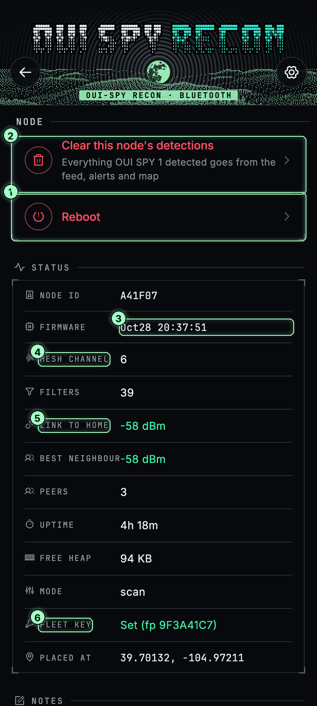
<table><tr><td width="340" valign="top"><ol><li><b>Reboot</b>: Restarts it; it drops off the mesh for a few seconds.</li><li><b>Clear detections</b>: Deletes what this node detected from this phone: from the feed, the alerts and the map (drones it reported stay).</li><li><b>Firmware build</b>: The build it runs.</li><li><b>Mesh channel</b>: The channel it is on: the home&#x27;s.</li><li><b>Link to home</b>: How loud the home hears it.</li><li><b>Fleet key</b>: Its fleet key is set: the mesh is encrypted with it (only its fingerprint shows).</li></ol></td></tr></table>
 

#### Install a preset

A preset installed on a node from the phone: the Recon relays it over the mesh, and the node adds its signatures to its filters (a node takes a preset only while its Detector runs).

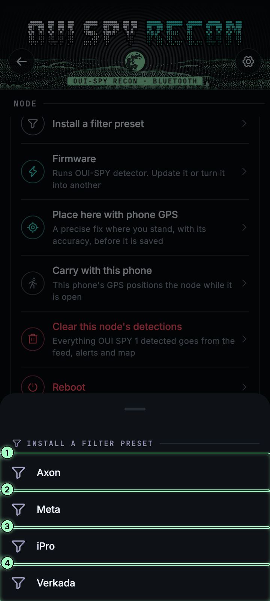
<table><tr><td width="340" valign="top"><ol><li><b>Axon</b>: Axon body cameras, TASERs and in-car units by their Bluetooth signatures.</li><li><b>Meta</b>: Ray-Ban and Oakley Meta smart glasses.</li><li><b>iPro</b>: i-PRO body cameras.</li><li><b>Verkada</b>: Verkada security cameras, by their Wi-Fi signatures; an OUI SPY on the OUI SPY build, or a Recon, refuses it (their Detector watches Bluetooth only).</li></ol></td></tr></table>
 

#### Fleet control

Fleet control: the whole fleet at once. Read every node, make them identify themselves, read their filters, set every remote's buzzer and LED.

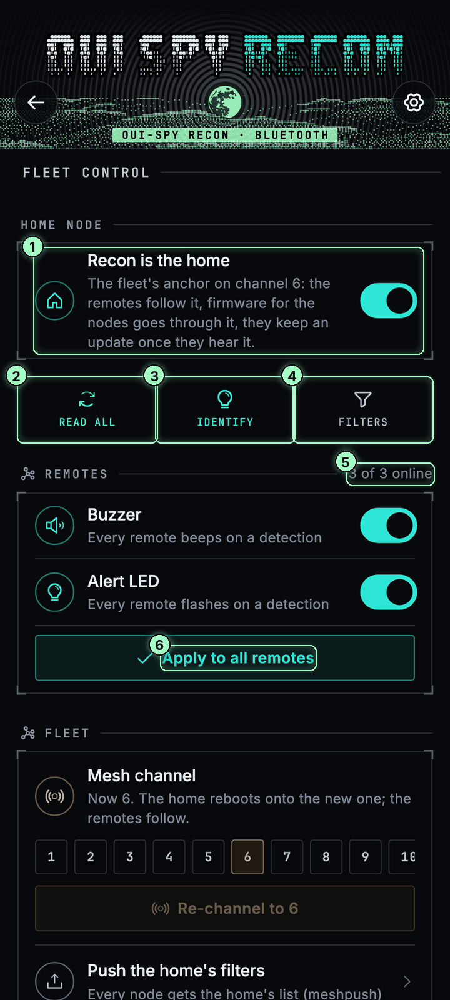
<table><tr><td width="340" valign="top"><ol><li><b>The home</b>: The board on the phone is the fleet&#x27;s home: the remotes follow it and send it their detections.</li><li><b>Read all</b>: Every node&#x27;s status, read again.</li><li><b>Identify all</b>: Every remote beeps and blinks its LED for 10 seconds; the board on your phone does not.</li><li><b>Read filters</b>: Every node&#x27;s filter list, read.</li><li><b>Remotes online</b>: How many remotes are heard.</li><li><b>Apply to all</b>: Sets every remote&#x27;s buzzer and alert LED at once.</li></ol></td></tr></table>
 

#### The mesh channel

Moving the fleet to another channel: pick it, then Re-channel. The home tells every remote, then reboots onto it; the remotes follow.

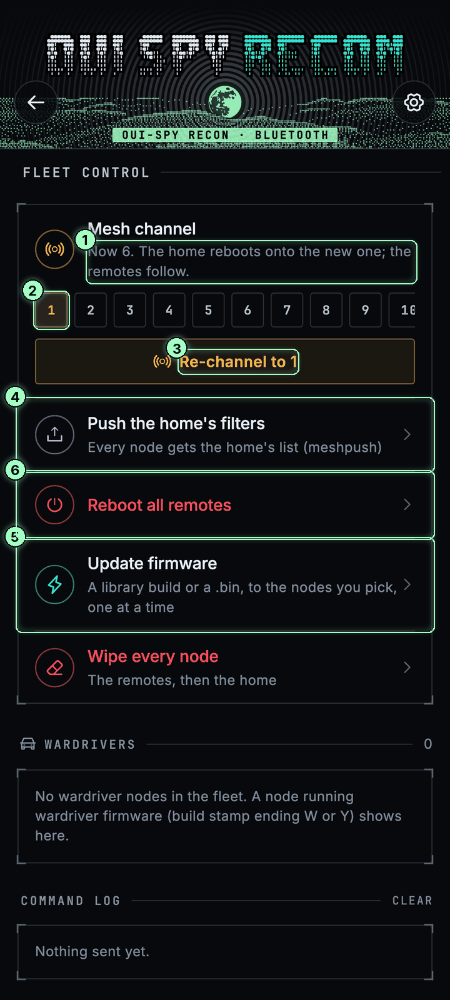
<table><tr><td width="340" valign="top"><ol><li><b>Channel now</b>: The channel the fleet is on now.</li><li><b>Pick a channel</b>: Channels 1 to 11 (the row scrolls): here 1 is picked.</li><li><b>Re-channel</b>: Moves the fleet (asks first).</li><li><b>Push filters</b>: Replaces every remote&#x27;s filter list with the home&#x27;s; the home&#x27;s Detector must be running.</li><li><b>Update firmware</b>: A build to the nodes you pick, one at a time, over the mesh.</li><li><b>Reboot remotes</b>: Restarts every remote; the home stays up.</li></ol></td></tr></table>
 

#### Mesh status

The mesh at a glance: who is up, its channel, rate and encryption, the fleet key, and who hears whom.

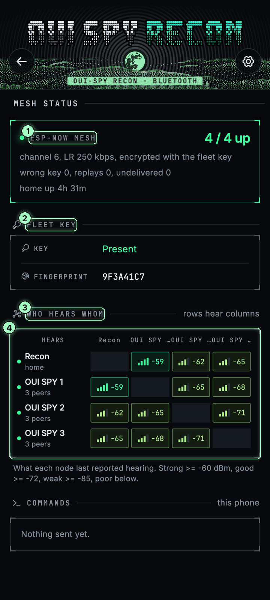
<table><tr><td width="340" valign="top"><ol><li><b>ESP-NOW mesh</b>: Nodes up, the channel, the long-range rate, encrypted with the fleet key, and how many frames failed the fleet key check.</li><li><b>Fleet key</b>: The key every node shares: present, and its fingerprint; it is never shown.</li><li><b>Who hears whom</b>: Each node&#x27;s neighbours, by signal: rows hear columns.</li><li><b>Signal grid</b>: Strong, good, weak or poor: where a node is out of reach of another.</li></ol></td></tr></table>
 

#### Triangulation

Triangulation on: the Axon body camera placed at its fix from the three OUI SPY nodes that hear it, a dashed line from each, its error ringed.

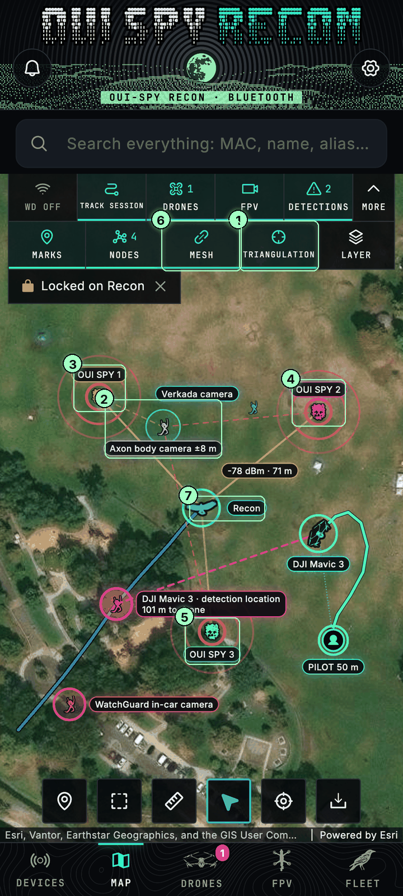
<table><tr><td width="340" valign="top"><ol><li><b>Triangulation on</b>: Places a device at its fix from three or more nodes that hear it.</li><li><b>Fix and error</b>: The device at its fix and how far off it may be: green when the fix is good, amber when rough.</li><li><b>OUI SPY 1</b>: One of the three nodes that hear it: the dashed line from it to the fix is coloured by its signal.</li><li><b>OUI SPY 2</b>: The second node that hears it; red rings pulse out as it detects.</li><li><b>OUI SPY 3</b>: The third: a fix needs three nodes placed on the map hearing it.</li><li><b>Mesh links</b>: The radio links between the nodes, each coloured by its signal; a link long enough on screen is labelled with its signal and length.</li><li><b>Home Recon</b>: The Recon, the home of the mesh: every node reports to it.</li></ol></td></tr></table>
 

### Firmware

The app carries the firmware for your OUI SPY boards and updates them over Bluetooth, USB or the mesh, one node at a time, checking each image before it is sent. A new board's first install is done with the [web flasher](https://colonelpanichacks.github.io/oui-spy-recon-app/flasher/).

#### Firmware over the mesh

Firmware for the nodes, from the phone: an image (here a detector build as a .bin file), checked, then sent over the mesh to the nodes you pick.

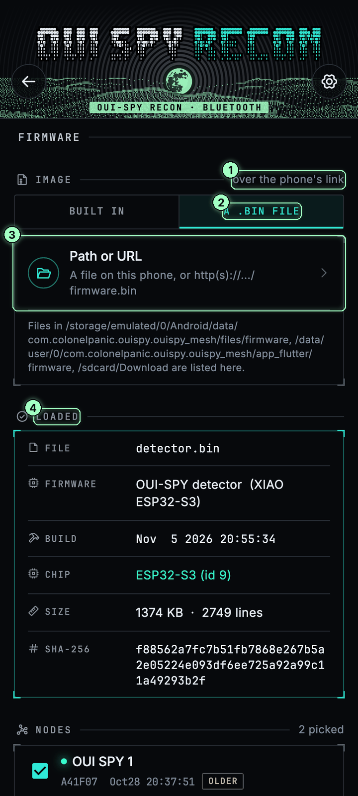
<table><tr><td width="340" valign="top"><ol><li><b>Over the link</b>: It goes to the board on the phone&#x27;s link first, then over the mesh.</li><li><b>Image source</b>: A build inside this app, or a .bin file on the phone or at a link.</li><li><b>Path or URL</b>: Pick the file.</li><li><b>Loaded image</b>: The app checks it is an ESP32-S3 app that fits the nodes before anything is sent; each board checks what it receives against the SHA-256.</li></ol></td></tr></table>
 

#### Sending over the mesh

The update under way: staged once on the board on the phone's link (here the Recon), then sent over the mesh to one node at a time. Each node's row says its step.

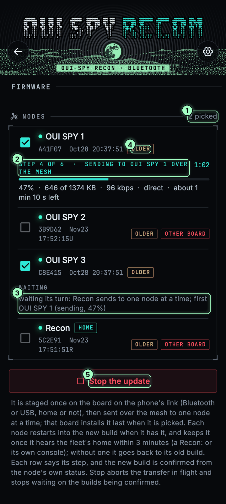
<table><tr><td width="340" valign="top"><ol><li><b>Picked nodes</b>: The nodes this update goes to.</li><li><b>Sending now</b>: Its step: the image going over the mesh, with its rate and time left.</li><li><b>Waiting its turn</b>: The next node waits: the Recon sends to one at a time.</li><li><b>Older build</b>: Current when it already runs this image, Older when it runs any other build (even a newer one), Other board when the image can&#x27;t go on it.</li><li><b>Stop</b>: Stops the transfer in flight.</li></ol></td></tr></table>
 

#### Firmware over USB

An OUI SPY on the phone's USB, updating its own firmware: a new build goes over the cable, the board checks it and saves it, then restarts into it.

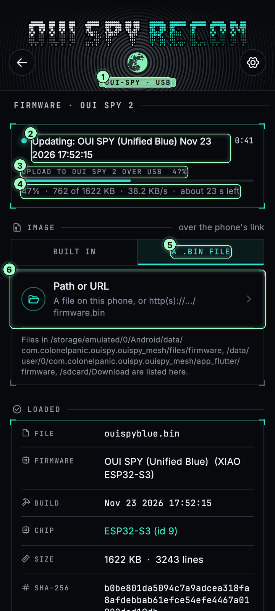
<table><tr><td width="340" valign="top"><ol><li><b>USB link</b>: The OUI SPY is on the phone&#x27;s USB (a USB OTG cable).</li><li><b>The update</b>: What is going on: the build, and how long it has run.</li><li><b>Over USB</b>: Step one: the image goes to the board over the cable.</li><li><b>Progress</b>: How much has gone, how fast, and the time left.</li><li><b>A .bin file</b>: The image: a build inside this app, or a .bin file on the phone or at a link.</li><li><b>Path or URL</b>: Picks the file.</li></ol></td></tr></table>
 

### Settings, exports and updates

Alerts and sounds, the map, Remote ID lookups, exports to CSV, JSON, KML and KMZ, and updates: the app looks on GitHub for a newer signed release and offers to install it.

#### Settings: alerts and the map

How alerts reach you on this phone, the home dashboard's connectors, and the map's settings.

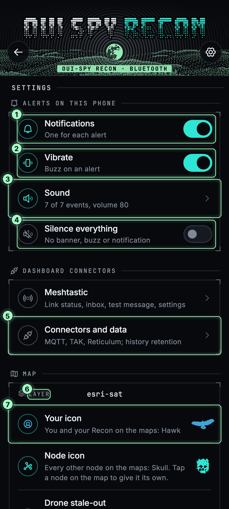
<table><tr><td width="340" valign="top"><ol><li><b>Notifications</b>: A notification for each alert.</li><li><b>Vibrate</b>: A buzz on an alert.</li><li><b>Sound</b>: Which events sound, and how loud.</li><li><b>Silence everything</b>: No sound, buzz, banner or notification, until you switch it off or the app restarts.</li><li><b>Connectors</b>: Sharing with ATAK on this phone, as CoT that any ATAK reads, the Play Store's too; with the home dashboard connected, also its MQTT, TAK and Reticulum links and how long it keeps history.</li><li><b>Map layer</b>: The map&#x27;s base layer.</li><li><b>Your icon</b>: You and your Recon on the maps.</li></ol></td></tr></table>
 

#### Export

Export (the last chip over the Feed): detections as CSV, JSON, KML or KMZ for Google Earth and ATAK, the devices the filters caught as CSV, and clearing detections.

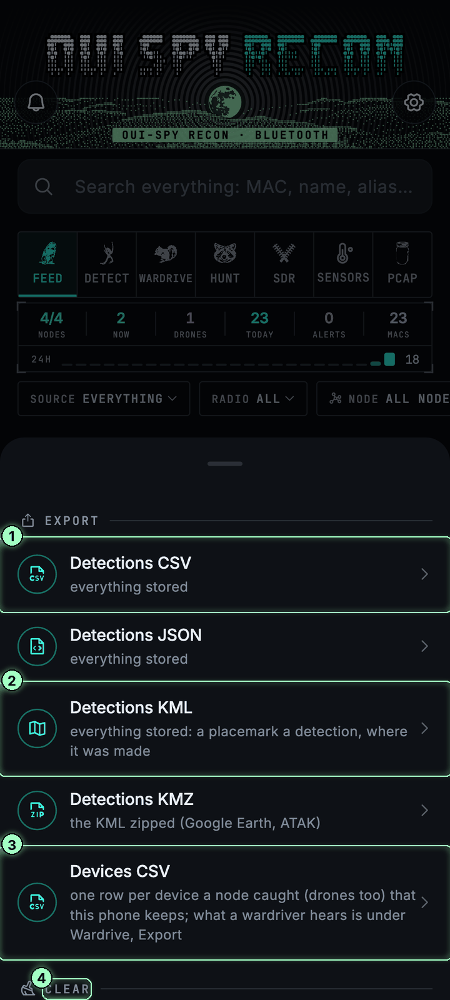
<table><tr><td width="340" valign="top"><ol><li><b>Detections CSV</b>: Every detection kept; if the list is narrowed by a search, a node or a radio, only those.</li><li><b>KML and KMZ</b>: A placemark per detection, where it was made (one with no known place is left out): Google Earth, ATAK.</li><li><b>Devices CSV</b>: One row per device the filters caught (drones too): first and last heard, hits, best signal and nodes. The wardrive&#x27;s networks and devices export from Wardrive.</li><li><b>Clear</b>: Deletes the stored detections (asks first).</li></ol></td></tr></table>
 

#### Settings: updates

The app's version, and Check for update: it looks on GitHub for a newer signed release and offers to install it. Here it has looked, and this build is the newest.

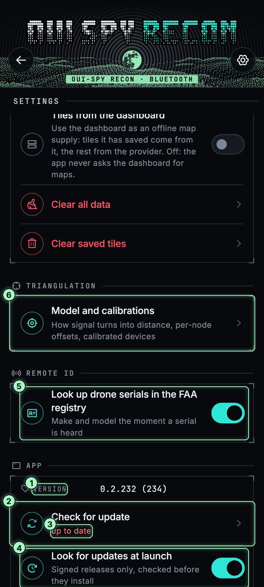
<table><tr><td width="340" valign="top"><ol><li><b>Version</b>: This build of the app.</li><li><b>Check for update</b>: Looks for a newer build now, and offers to install it.</li><li><b>Up to date</b>: What the last look found.</li><li><b>At launch</b>: Looks by itself when the app opens.</li><li><b>FAA lookups</b>: A drone&#x27;s make and model from its serial, the moment it is heard.</li><li><b>Triangulation</b>: How signal turns into distance, for placing devices.</li></ol></td></tr></table>
 

### With an OUI SPY

An OUI SPY runs the same modes, with the app as its screen. The screens for the Recon's extra hardware stay in the app, greyed out: FPV, SDR, Sensors, 5 GHz and 802.15.4 in PCAP, the spin sweep, and the Recon's GPS, Wi-Fi and map download.

#### OUI SPY: board and mesh

Fleet > Board with an OUI SPY: what it is and what it runs, and its mesh, set from here: it has no screen of its own.

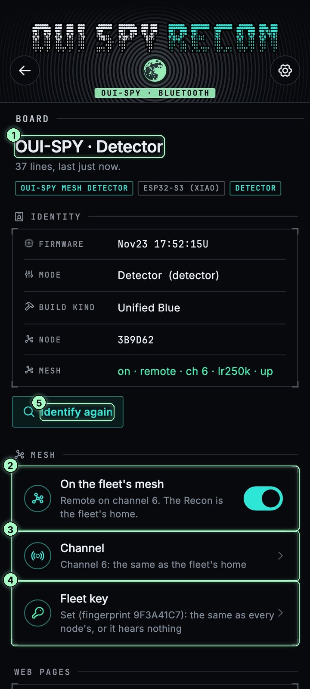
<table><tr><td width="340" valign="top"><ol><li><b>What it is</b>: An OUI SPY on the OUI SPY build of the Recon&#x27;s firmware, running its Detector.</li><li><b>On the mesh</b>: Joins the fleet as a remote: the Recon is the fleet&#x27;s home.</li><li><b>Mesh channel</b>: Its channel: the same as the fleet&#x27;s home.</li><li><b>Fleet key</b>: The key every node shares; typed in once, never shown.</li><li><b>Identify again</b>: Asks the board again what it is.</li></ol></td></tr></table>
 

#### With an OUI SPY

An OUI SPY on the phone instead of a Recon: the same app. What needs the Recon's second chip (its C5) stays in place, greyed out.

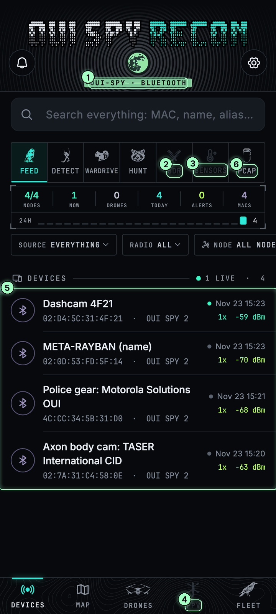
<table><tr><td width="340" valign="top"><ol><li><b>OUI SPY link</b>: The OUI SPY over Bluetooth. Only the moon lights up: the mountains rise for a Recon.</li><li><b>SDR greyed</b>: The SDR runs on the Recon&#x27;s C5: greyed out, it takes no taps.</li><li><b>Sensors greyed</b>: The Grove sensors are on the Recon&#x27;s C5 too.</li><li><b>FPV greyed</b>: The 5.8 GHz video receiver is the Recon&#x27;s: the tab stays, greyed out.</li><li><b>What it caught</b>: What the OUI SPY caught itself in Detector mode, over Bluetooth: Axon gear, smart glasses, Motorola gear, and the dashcam flagged earlier.</li><li><b>Still working</b>: Feed, Detect, Wardrive, Hunt and PCAP, on what the OUI SPY&#x27;s one radio hears: Bluetooth, and 2.4 GHz Wi-Fi unless AXEOFF or Sky Spy holds it. Wi-Fi watch rules and the spin sweep need a Recon.</li></ol></td></tr></table>
 

#### OUI SPY: capture

PCAP with an OUI SPY: it captures 2.4 GHz Wi-Fi (not while AXEOFF or Sky Spy runs) and Bluetooth, and with no card it keeps the first 1 MB of a capture in memory. 5 GHz Wi-Fi and 802.15.4 need the Recon's C5 and are greyed out.

<table><tr><td width="340" valign="top"><ol><li><b>PCAP</b>: Every radio&#x27;s packets at once, as Wireshark lists them.</li><li><b>5 GHz greyed</b>: 5 GHz Wi-Fi needs the Recon&#x27;s C5: greyed out, no taps.</li><li><b>Zigbee greyed</b>: 802.15.4 (Zigbee, Thread) needs the C5 too.</li><li><b>Packets or probes</b>: The live packet list, or the probe database.</li><li><b>Its radios</b>: Packets a second on each radio; Kept is the file on the Recon&#x27;s card (an OUI SPY has none).</li></ol></td></tr></table>
 

#### OUI SPY: settings

Settings with an OUI SPY: it has no GPS and no Wi-Fi network of its own, so the Recon's GPS and Wi-Fi settings stay, greyed out. The phone's GPS goes to it.

<table><tr><td width="340" valign="top"><ol><li><b>GPS greyed</b>: The Recon&#x27;s GPS choices, greyed out: an OUI SPY always takes the phone&#x27;s.</li><li><b>Phone GPS</b>: What the OUI SPY uses: this phone&#x27;s position.</li><li><b>Wi-Fi greyed</b>: The Recon&#x27;s Wi-Fi network, for map tiles and FAA lookups: greyed out.</li><li><b>Map download</b>: The Recon&#x27;s card: greyed out too.</li></ol></td></tr></table>
 

#### OUI SPY or OUI SPY Recon

The app works with both.

| | OUI SPY | OUI SPY Recon |
|---|:---:|:---:|
| Bluetooth: surveillance gear, drones, trackers, every device | yes | yes |
| Detections and watch rules on Bluetooth | yes | yes |
| Detections and watch rules on Wi-Fi (2.4 and 5 GHz) and 802.15.4 | AXEOFF's Axon signatures only (2.4 GHz) | yes |
| Drones: Remote ID over Bluetooth and 2.4 GHz Wi-Fi | yes, while Sky Spy runs | yes |
| Drones: Remote ID over 5 GHz | | yes |
| Modes: Detector, Foxhunter, PCAP, Sky Spy, BLE Sniff, AXEOFF, Mesh node | yes | yes |
| Wardriving | Bluetooth, 2.4 GHz Wi-Fi (not while AXEOFF or Sky Spy runs) | Bluetooth, 2.4 and 5 GHz Wi-Fi, 802.15.4 |
| Packet capture | Bluetooth, 2.4 GHz Wi-Fi (not while AXEOFF or Sky Spy runs), the first 1 MB kept in memory | adds 5 GHz Wi-Fi and Zigbee, saved to its card |
| Hunting a device (FIND IT) | yes | yes, plus the spin sweep |
| Long-range mesh, fleet view, firmware over the mesh | yes | yes, the mesh's home |
| Triangulation, with three boards placed on the map | yes | yes |
| 5.8 GHz FPV video | | yes |
| Grove sensors | | yes |
| Its own screen, card, GPS, motion sensor, microphone | | yes |

## Download

The newest version is on the [Releases](https://github.com/colonelpanichacks/oui-spy-recon-app/releases/latest) page.

| Platform | File |
|---|---|
| Android 9 and newer | `oui-spy-recon-<version>.apk` |
| macOS | `oui-spy-recon-<version>-macos.zip` |

**Android.** Open the APK on the phone and allow the install when Android asks.

**macOS.** Unzip it and move `OUI SPY.app` to Applications. The first time you open it, macOS asks
you to confirm: open System Settings, Privacy & Security, and choose Open Anyway.

## Updates

Once it is installed, the app looks here for a newer release, at launch and from Settings, and
installs it from Settings.

Every release carries `release.json`, a manifest that names the release and every file in it with
its size and SHA-256. It is signed with an Ed25519 release key, and the app has the public half of
each release key built in. Before the app installs anything it checks:

- that the manifest is signed by one of them;
- that the release is newer than the version installed, never older;
- that the file it downloaded is exactly the one the manifest names.

A release that fails any check is refused. A change to a release or a file on GitHub cannot reach
your device without the release key. On Android the APK must also be signed with the app's own
signing key, or Android refuses it. On the Mac the new app must also pass codesign's check that its
bundle is intact.

Update checks and downloads go over HTTPS to GitHub's own servers only. No account, token or
device details are sent with them.

<b>Checking a download yourself</b>

Release key (Ed25519, key id `6ad53ce485f65f52`):

    phdKnWp0AJpsdG6yLKhh1QnRfKKSJhblLxJyaTX2ncg=

Android signing certificate, SHA-256:

    55:B2:D2:CB:0F:54:86:ED:92:00:8E:26:BD:4C:C8:F4:1B:4A:C3:B1:94:7E:74:BB:D4:67:EC:E3:6A:A8:D2:75

With `release.json` and the files from a release in one folder, and OpenSSL 3:

    python3 -c "import json,base64; d=json.load(open('release.json')); open('m.txt','wb').write(d['manifest'].encode()); open('m.sig','wb').write(base64.b64decode(d['sig']))"
    (printf '302a300506032b6570032100' | xxd -r -p; printf 'phdKnWp0AJpsdG6yLKhh1QnRfKKSJhblLxJyaTX2ncg=' | base64 -d) > release-key.der
    openssl pkeyutl -verify -pubin -inkey release-key.der -keyform DER -rawin -in m.txt -sigfile m.sig

It prints `Signature Verified Successfully`. Then compare each file's SHA-256 (`shasum -a 256 <file>`)
with the one `m.txt` gives for it.

To check the APK's signing certificate:

    apksigner verify --print-certs oui-spy-recon-<version>.apk

## Thanks

Thanks and a shout-out to:

- **[WiGLE](https://wigle.net)**, the wardriving database the app uploads to. [Mastodon](https://defcon.social/@WiGLEnet) · [GitHub](https://github.com/wiglenet)
- **NitekryDPaul**, for the many OUI submissions: [nite-oui-collection](https://github.com/nitekry/nite-oui-collection). [X](https://x.com/NitekryDPaul) · [GitHub](https://github.com/nitekry)
- **cybertiger** at the [EFF](https://www.eff.org). [Bluesky](https://bsky.app/profile/cooperq.com) · [GitHub](https://github.com/cooperq)
- **DeFlock Joplin**, for the wildcard probe-request detection research. [deflockjoplin.today](https://deflockjoplin.today) · [Bluesky](https://bsky.app/profile/deflockjoplin.bsky.social)
- **Joe "The Mayor" Helle**, for help with the Android app. [X](https://x.com/joehelle) · [GitHub](https://github.com/dievus)
- **Konrad Iturbe** (KonradIT), for the C5VRX link mode the Recon's FPV video runs on. [konraditurbe.dev](https://konraditurbe.dev) · [Bluesky](https://bsky.app/profile/konraditurbe.dev) · [GitHub](https://github.com/KonradIT)

Shout-outs to **the wrew** ([Mastodon](https://masto.hackers.town/@Wrewdison) · [wrewtopia.com](https://wrewtopia.com)), **dz_az** and **h4d35x0** ([GitHub](https://github.com/h4d35x0) · [h4d35x0.com](https://h4d35x0.com)).

## License

MIT: see [LICENSE](LICENSE).

## OUI SPY Recon

  
  

The handheld built around everything above. It has a screen of its own and a second radio chip (ESP32-C5), which brings 5 GHz Wi-Fi, 802.15.4 and 5.8 GHz FPV video. It also has a Grove port for sensors and its own GPS, and it runs the mesh. Coming.
