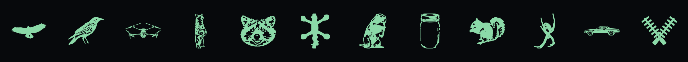

# The mesh

Your boards talk to each other directly over a long-range Wi-Fi link, with no router, no internet and no account. Link the app to any one of them and you see, map and command the whole fleet.

- [What it is](#what-it-is)
- [Home and remotes](#home-and-remotes)
- [Set it up](#set-it-up)
- [Run the fleet](#run-the-fleet)
- [What travels over the mesh](#what-travels-over-the-mesh)
- [One OUI SPY, or a fleet](#one-oui-spy-or-a-fleet)
- [Limits](#limits)

## What it is

- **ESP-NOW long range** on the boards' 2.4 GHz radio, at 250 kbit/s (the app shows it as "LR 250 kbps"). Channels 1 to 11; a fresh board starts on 6.
- **Every node relays.** A message can hop through up to 4 other nodes on its way.
- **Detections arrive.** The home acknowledges each one, and the sender keeps resending it for up to 30 seconds until it does.
- **The fleet key** is one shared secret you type into every node. With it, every message is sealed, and commands are signed and can't be replayed. A node without the same key can't read your fleet. The app and the boards only ever show the key's fingerprint, never the key.
- **Without a key** a board answers only harmless requests (status, identify, locate, reading its filters) and refuses everything that would change it.
- **One fleet, many boards.** A Recon, OUI SPYs and the older OUI SPY detector nodes speak the same mesh and can share one fleet.

The mesh is separate from your phone's own link to its board, which is Bluetooth or USB.

## Home and remotes

| Role | What it does |
|---|---|
| **Home** | The fleet's anchor. It never searches other channels (only a re-channel moves it, and the fleet with it), the remotes follow it, and it takes their detections. |
| **Remote** | Follows the home's channel. Its detections go to the home and to every node. |
| **Mesh node** mode | A relay, or the home, that does no scanning of its own. |
| **Mesh off** | The board talks to your phone only. |

On a fresh board the mesh is off. When it goes on, a Recon is the **home** and an OUI SPY is a **remote**. One home per fleet works best.

## Set it up

### A remote node from the web flasher

A **Detector**, **Sky-Spy** or **Wardriver** node needs no phone of its own. On the [web flasher](https://colonelpanichacks.github.io/oui-spy-recon-app/flasher/), pick it and install it, then set it up on the page over the same USB cable: the mesh channel, the fleet key (the page can generate one, and shows its fingerprint), a name, and a lock so it starts in the mesh after every power cut. It joins as a remote. The board on your phone is the home: give it the same key and channel in the app (below).

### An OUI SPY joining your fleet

An OUI SPY has no screen, so the app sets up its mesh.

1. **Link it.** **Settings > Connections > Board over Bluetooth**, pick **OUI-SPY &lt;id&gt;**, or use **Board on USB**. The first Bluetooth link asks for its 6-digit PIN: **123456** on a new board. Change it with `blepin <6 digits>` (not starting with 0) in the app's **Console** while the board is on USB.
2. **Open Fleet > Board.** The title reads **OUI-SPY · &lt;mode&gt;**, and the **Mesh** group sits under the board's card.
3. **Mesh > Fleet key.** Type your fleet's key: 8 to 63 characters, no spaces, the same on every node. The row then reads **Set (fingerprint ...)**. Check it matches your other nodes' fingerprint.
4. **Mesh > On the fleet's mesh.** Switch it on. The board restarts and joins as a remote, and the app links to it again by itself.
5. **Same channel as the home.** If your home is on another channel: **Mesh > Channel > Mesh channel > Channel &lt;n&gt;**. The board restarts again.
6. **Check it.** The **Fleet** tab lists your home with a **Home** tag and the other nodes ("&lt;n&gt; of &lt;m&gt; online"). **Fleet > Mesh** says it is **encrypted with the fleet key**.
7. **Name it.** **Fleet >** tap the node **> Rename**. The name goes to the node too.
8. **Give it a place** (for maps and triangulation): node page **> Actions > Place here with phone GPS**. While your phone stays linked to an OUI SPY, the OUI SPY also takes the phone's GPS and shares its position on the mesh.

### A Recon

A Recon sets its mesh on its own screen: the **MESH** tile **> SETUP** (mesh on or off, home or remote, channel) and **SECURITY** (the fleet key, typed on its screen, and its name). From the app, **Fleet > Control > Home node** makes the board on your phone's link the home, or a remote again.

## Run the fleet

From a phone linked to the fleet's home (from a remote, these commands act from that remote):

- **The whole fleet:** **Fleet > Control**.
  - **Read all**, **Identify** (every remote beeps and blinks its LED for 10 seconds), and **Filters** (read every node's rules).
  - Buzzer and alert LED for every remote, **Push the home's filters** (replaces every remote's filter list with the home's; the home's Detector must be running), **Reboot all remotes**, **Update firmware**.
  - **Re-channel to &lt;n&gt;** moves the whole fleet: the home tells every remote, then moves.
- **One node:** **Fleet >** tap it.
  - Rename, colour, **On a detection** (buzzer, alert LED), Identify, **Beep three times**, Locate, Read status.
  - **Filters on the node**, **Install a filter preset**, Firmware, **Place here with phone GPS**, **Carry with this phone**, **Clear this node's detections**, Reboot.
  - **Security**: **Report lost**, **Wipe**, and **Forget** once the node is offline.
- **Watch for a device everywhere:** **Devices > Detect > Signatures > Install on nodes** adds your watch list to the nodes you tick (the online detectors, OUI SPYs and Recons come ticked), one node after another. A Recon or an OUI SPY takes them while its Detector runs (**Fleet > Board > Switch mode > Detector**).
- **Firmware over the mesh:** **Fleet > Firmware > Built in > OUI SPY (Unified Blue)**, tick the OUI SPY nodes, and install. Each one checks the image against its SHA-256 before it boots it.
- **Check the mesh:** **Fleet > Mesh** shows the nodes up, the channel, the rate, the encryption, any wrong-key or replayed messages, and **Who hears whom**. **Fleet > Control > Command log** shows each command sent from Fleet control, with its result.

## What travels over the mesh

| What | Details |
|---|---|
| Detections | A device when it is first seen (or again after 5 minutes unseen), then a signal update at most every 10 seconds. Every Detector filter hit, every AXEOFF hit, and the target a Foxhunter is hunting. |
| Drones | Every Remote ID drone heard (Sky Spy), with its pilot. A Recon adds 5 GHz Remote ID. |
| Node status | Each node's role and channel, and on request its build, rules, neighbours, uptime and key fingerprint. |
| Positions | A node's position every 10 seconds (sooner once it moves 10 m): a Recon's own GPS or a phone's. An OUI SPY shares one only while a phone is linked to it. |
| Wardrive finds | Wi-Fi and Bluetooth finds in batches, with the sender's position when it has one. |
| Commands | Buzzer and LED, reboot, channel, status, identify, locate, names, rules and presets, wipe. |
| Firmware | A signed offer, then the image in sealed pieces. The node checks its SHA-256 before booting it. |

Video, capture files and logs stay on each board's own USB or Bluetooth link; they don't go over the mesh.

## One OUI SPY, or a fleet

**One OUI SPY and a phone** (mesh off). The app is its screen. **Fleet > Board > Switch mode** runs any mode in place: Detector with presets and rules, Foxhunter, PCAP, Sky Spy, BLE Sniff, AXEOFF or Mesh node. Its detections and wardrive finds come to the phone with the phone's GPS. Its wardriver logs Bluetooth and 2.4 GHz Wi-Fi. After a dropped link the app collects what it kept in memory, and firmware updates go over the same link.

**Several OUI SPYs and a Recon** (one fleet). The Recon is the home, and every OUI SPY joins as a remote on the same channel with the same fleet key.

- Every OUI SPY sends its detections, drones and wardrive finds over the mesh.
- The Recon's own screen shows the whole fleet, with or without a phone.
- A phone linked to the Recon sees and commands every node. A phone linked to any OUI SPY sees the fleet through it too.
- With three or more placed nodes hearing the same device within 45 seconds, the app triangulates it on the map.

## Limits

- **One radio.** An OUI SPY has a single 2.4 GHz radio, shared in turns by Bluetooth scanning, Wi-Fi sniffing, the mesh and your phone's link.
  - While a phone is linked, scanning gets 30% of the radio by default (`blescan` in the Console changes it).
  - With no phone linked, scanning gets all of it.
- **PCAP mode** keeps the mesh running. On an OUI SPY the capture and the mesh share one radio, so the mesh is slower while a capture runs.
- **Sky Spy** listens on channel 6, so a fleet on channel 6 hears the most drones.
- **Lost remotes.** A remote that hasn't heard its fleet for about 2 minutes searches channels 1 to 11 for it. It doesn't search while it is sniffing Wi-Fi or running a Wi-Fi access point.
- **Firmware** goes over the mesh to one node at a time and needs the same fleet key. The app never sends a node another board's image. A remote keeps a new build once it hears the home within 3 minutes of restarting (an OUI SPY on the OUI SPY build, or a Recon, also keeps it when a phone sends it a command over its own link); otherwise it goes back to its old build. A home, or a board with its mesh off, keeps it after a minute.

